---
# the title slide is the #navn slide below; pagetitle only sets the browser tab
pagetitle: "AI-revolusjonen"
author-meta: "Simen Eide"
lang: no
format:
  revealjs:
    theme: default
    css: custom.css
    slide-number: true
    transition: fade
    width: 1280
    height: 800
    controls: false
    include-after-body: scripts.html
    resources:
      - pascal.js
      - tree.js
      - steps.js
      - lm.js
      - agent.js
---

# {#navn .stage-slide .nonum}

::: {.stage .navn-stage}

::: {.ki}
[AI[KI]{.new data-show="1"}]{.old}-revolusjonen
:::

::: {.sub}
I tre deler
:::

::: {.byline}
Simen Eide\
Tech Day, Norges Bank, 6. november 2026
:::

::: {.terms data-show="2"}
[Statistics]{} [Machine learning]{} [Statistical learning]{} [Big data]{} [Data science]{} [Deep learning]{} [Data mining]{} [Predictive analytics]{} [Pattern recognition]{} [Neural networks]{} [Expert systems]{} [Cybernetics]{} [Econometrics]{} [Business intelligence]{} [Soft computing]{}
:::

::: {.trump data-show="3"}


[«We will be officially BANNING the term, ‹AI/Artificial Intelligence› (…)\
We should call it SI (Super Intelligence) instead»]{.say data-show="4"}
:::

::: {.si data-show="5"}
[S]{.hl}tatistical [I]{.hl}ntelligence
:::

::: {.credit data-show="3"}
Foto: Gage Skidmore, CC BY-SA 2.0. Sitat: Donald J. Trump, Truth Social, okt. 2026.
:::

:::

[]{.fragment .gstep}
[]{.fragment .gstep}
[]{.fragment .gstep}
[]{.fragment .gstep}
[]{.fragment .gstep}

::: notes
Tittelen er AI-revolusjonen. På norsk skal vi jo si KI.

Feltet har hatt mange navn: statistikk, maskinlæring, statistisk læring, big data, data science, deep learning, økonometri. Navnet skifter hvert tiår, innholdet er mye det samme. Det spiller egentlig ingen rolle hva vi kaller det.

Trump har nettopp skrevet på Truth Social at AI er et «very bad and inaccurate name», at det skal hete SI, Super Intelligence, og at begrepet AI skal forbys. Det kom etter presidentordren 29. september.

Jeg foreslår at vi tar ham på ordet: SI. Men Statistical Intelligence. Det er det dette foredraget handler om.
:::

## Om meg {#om-meg .stage-slide}

::: {.me}


- Matematiker (PhD, bayesianske nevrale nett)
- Porteføljerisiko
- Anbefalingssystemer (FINN.no)
- AI enablement & labs (Schibsted)
- Nå: freelance, lage AI med AI og litt formidling
:::

::: {.stage .naa-stage}

::: {.quote .q1 data-show="1"}
[2023 · Sven (sjefen) på allmøte]{.who}

«Det er nå det skjer! Er det ikke, Simen?»
:::

::: {.quote .q2 data-show="2"}
[2023 · Simen, fagekspert]{.who}

«Slapp av. Det er bare transformere fra 2017 med mer data. Imponerende forskning, men …»
:::

::: {.quote .q3 data-show="3"}
[Mars 2026 · Simen, fra talerstolen i en kirke i Kristiansand]{.who}

«DET ER NÅ DET SKJER!!!»
:::

:::

[]{.fragment .gstep}
[]{.fragment .gstep}
[]{.fragment .gstep}

::: notes
Matematiker, PhD på bayesianske nevrale nett. Startet med porteføljerisiko i finans, så anbefalingssystemer på FINN.no, så AI enablement & labs i Schibsted. Nå eide.ai.

I 2023 sto sjefen min på allmøte og sa at det er nå det skjer. Jeg var fageksperten som sa slapp av, det er bare transformere med mer data. I mars 2026 sto jeg selv i en kirke i Kristiansand og ropte det samme. Hva skjedde?
:::

# Fundamentet

## {#pascal .stage-slide}

::: {.stage}

<div class="stage-title" data-title-0="Paris, 1654" data-title-7="Spillet avbrytes" data-title-8="Hvordan deler de potten rettferdig?"></div>

<div class="figure left">
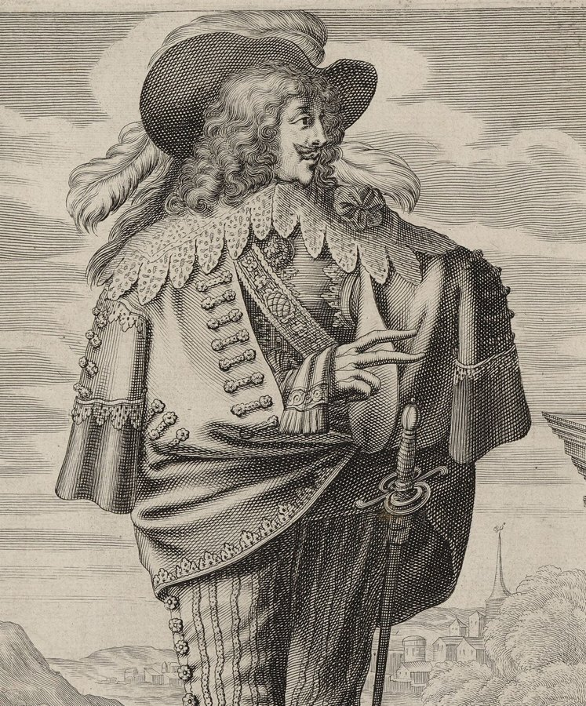
<div class="name">Chevalier de Méré</div>
<div class="pips" data-player="A"><span></span><span></span><span></span></div>
</div>

<div class="figure right">

<div class="name">Blaise Pascal</div>
<div class="pips" data-player="B"><span></span><span></span><span></span></div>
</div>

<div class="bubble">Monsieur Pascal,<br>jeg har et problem med et spill.</div>

<div class="pot"></div>
<div class="pot-label">64 gullmynter</div>

<div class="toss">
<div class="shadow"></div>
<div class="flipper">
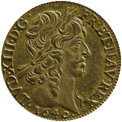
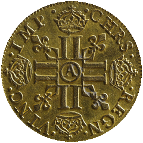
</div>
<div class="toss-result"></div>
</div>

<div class="rule">
 Kron: de Méré får poeng
<span class="sep">·</span>
 Mynt: Pascal får poeng
<span class="sep">·</span>
Først til <b>3</b> vinner potten
</div>

<div class="poll">
<div class="poll-head">
<div class="who"><div class="mini-pips"><i class="on"></i><i class="on"></i><i></i></div><div class="who-name">de Méré</div></div>
<div class="who"><div class="mini-pips"><i class="on"></i><i></i><i></i></div><div class="who-name">Pascal</div></div>
</div>
<div class="row" data-row="9" data-split="32,32"><b>A</b><div class="txt">Del likt<span>Spillet ble aldri ferdig.</span></div><div class="piles"></div></div>
<div class="row" data-row="10" data-split="64,0"><b>B</b><div class="txt">De Méré tar alt<span>Han leder.</span></div><div class="piles"></div></div>
<div class="row" data-row="11" data-split="43,21"><b>C</b><div class="txt">Del etter poeng<span>Han har vunnet 2 av 3 runder.</span></div><div class="piles"></div></div>
<div class="row" data-row="12" data-split="48,16"><b>D</b><div class="txt">Del ¾ og ¼</div><div class="piles"></div></div>
</div>
<div class="point"></div>
<div class="stamp">STOPP</div>

<div class="credit">Bilder: A. Bosse, The Met, Musée Carnavalet.</div>

:::

<!-- one empty fragment per step; pascal.js renders the state from the step count -->
<span class="fragment step"></span>
<span class="fragment step"></span>
<span class="fragment step"></span>
<span class="fragment step"></span>
<span class="fragment step"></span>
<span class="fragment step"></span>
<span class="fragment step"></span>
<span class="fragment step"></span>
<span class="fragment step"></span>
<span class="fragment step"></span>
<span class="fragment step"></span>
<span class="fragment step"></span>

## {#tree .stage-slide}

::: {.stage .tree-stage}

<div class="stage-title tree-title" data-title-0="Pascals løsning" data-title-5="Pascals løsning: 48 / 16"></div>

<svg class="edges" width="1280" height="800" viewBox="0 0 1280 800">
<path class="e e1" d="M 250 400 C 340 400, 360 220, 470 220"/>
<path class="e e2" d="M 250 400 C 340 400, 360 560, 470 560"/>
<path class="e e3" d="M 620 560 C 700 560, 720 470, 800 470"/>
<path class="e e4" d="M 620 560 C 700 560, 720 650, 800 650"/>
</svg>

<div class="node root"><div class="sc">2 – 1</div><div class="who-mini"></div></div>

<div class="elabel l1"> ½</div>
<div class="elabel l2"> ½</div>
<div class="elabel l3"> ½</div>
<div class="elabel l4"> ½</div>

<div class="node n1 mere"><div class="sc">3 – 1</div><span>de Méré vinner</span><b>½</b></div>
<div class="node n2"><div class="sc">2 – 2</div><span>likt</span></div>
<div class="node n3 mere"><div class="sc">3 – 2</div><span>de Méré vinner</span><b>¼</b></div>
<div class="node n4 pascal"><div class="sc">2 – 3</div><span>Pascal vinner</span><b>¼</b></div>

<div class="sum">
<div class="srow mere"><span class="p">½ + ¼ = <b>¾</b></span><span class="x">¾ × 64 = <b>48</b></span><div class="sp" data-n="48"></div></div>
<div class="srow pascal"><span class="p"><b>¼</b></span><span class="x">¼ × 64 = <b>16</b></span><div class="sp" data-n="16"></div></div>
</div>

<div class="insight">Ikke hva som <i>har</i> skjedd, men hva som <i>kan</i> skje.<div class="formula">P(vinne | stillingen nå) × potten</div><div class="ev"><div class="eq">=</div><div class="evt">Forventningsverdi</div></div></div>

:::

<span class="fragment tstep"></span>
<span class="fragment tstep"></span>
<span class="fragment tstep"></span>
<span class="fragment tstep"></span>
<span class="fragment tstep"></span>
<span class="fragment tstep"></span>
<span class="fragment tstep"></span>

## {#spread .stage-slide}

::: {.stage .spread-stage}

::: {.stage-title}
På et par tiår gikk verden fra å ikke forstå sannsynligheter til at det var overalt
:::

::: {.cases}

::: {.case}


[1654]{.y} [Spill]{.d}

Pascal og Fermat: hvordan dele potten
:::

::: {.case}


[1657]{.y} [Vitenskap]{.d}

Huygens: første lærebok. Hva er et spill verdt?
:::

::: {.case}


[1662]{.y} [Folkehelse]{.d}

Graunt telte Londons dødsfall: av 100 fødte lever 16 ved 36 år
:::

::: {.case}
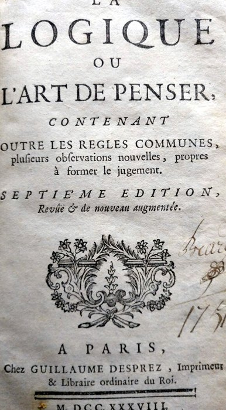

[1662]{.y} [Hverdagen]{.d}

Port-Royal: frykten for lyn bør stå i forhold til sjansen
:::

::: {.case}


[1665]{.y} [Jus]{.d}

Leibniz (19 år): rettigheter som tall, 0, ½ og 1
:::

::: {.case}
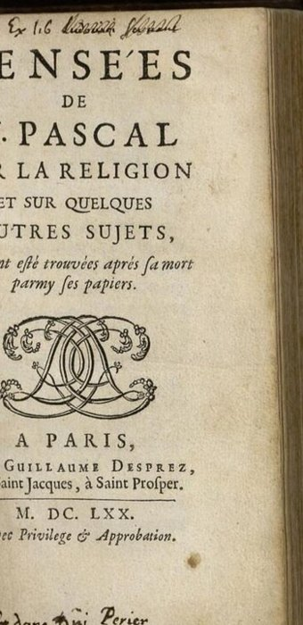

[1670]{.y} [Religion]{.d}

Pascals veddemål: tro, fordi gevinsten er uendelig
:::

::: {.case .last}


[1671]{.y} [Statsobligasjoner]{.d}

de Witt: hva er en livrente verdt?
:::

:::

::: {.credit}
Bilder: C. Netscher, Wellcome/Wikimedia, Port-Royal (1662), C. B. Francke, Bibliothèque municipale de Lyon (Pensées), J. de Baen.
:::

:::


::: notes
Folk hadde spilt med terninger i tusenvis av år uten å regne på sjansene. Ingen tenkte i sannsynligheter. På et par tiår gikk verden fra det til at sannsynlighet var overalt. Det er en konseptuell revolusjon, ikke bare en ny formel (Ian Hacking, The Emergence of Probability, 1975):

- 1654 Pascal og Fermat løser problemet med potten (det vi nettopp så).
- 1657 Huygens skriver den første læreboka: verdien av et spill, forventningsverdien.
- 1662 John Graunt teller ukentlige dødslister i London og lager den første dødelighetstabellen. Av 100 fødte lever 64 ved 6 år, 16 ved 36, 1 ved 76.
- 1662 Port-Royal-logikken: folk er livredde for lyn, men frykten bør stå i forhold til hvor sannsynlig det er, ikke bare hvor ille det er.
- 1665 Leibniz, 19 år, doktoravhandling i jus: en betinget rettighet er et tall mellom 0 og 1.
- 1670 Pascals veddemål: tro på Gud, fordi forventet gevinst er uendelig. Beslutningsteori.
- 1671 de Witt priser livrenter for staten.

Spill, vitenskap, folkehelse, hverdag, jus, religion og statsfinans. Etter dette tenker folk i sannsynligheter.
:::

## {#dewitt .stage-slide}

::: {.stage .dewitt-stage}

<div class="stage-title" data-title-0="1671: Holland trengte krigspenger"></div>

<div class="dw-portrait" data-show="4"><div class="dw-name">Johan de Witt</div><div class="dw-role">statsminister og matematiker</div></div>

<div class="annuity">
<div class="a-line" data-show="1" data-hide="5">Utstedte obligasjon: få <b>én gullmynt</b> i året så lenge du lever.</div>
<div class="a-line pris" data-show="2">Pris: <b>14 gullmynter</b></div>
<div class="a-line" data-show="3" data-hide="5">Fair?</div>
</div>

<div class="chart" data-show="5">
<svg width="820" height="400" viewBox="0 -10 820 410">
<line x1="70" y1="340" x2="790" y2="340" class="ax"/><line x1="70" y1="20" x2="70" y2="340" class="ax"/>
<line x1="70.0" y1="340" x2="70.0" y2="346" class="tk"/><text x="70.0" y="370" class="tl">3</text><line x1="219.3" y1="340" x2="219.3" y2="346" class="tk"/><text x="219.3" y="370" class="tl">20</text><line x1="394.9" y1="340" x2="394.9" y2="346" class="tk"/><text x="394.9" y="370" class="tl">40</text><line x1="570.5" y1="340" x2="570.5" y2="346" class="tk"/><text x="570.5" y="370" class="tl">60</text><line x1="746.1" y1="340" x2="746.1" y2="346" class="tk"/><text x="746.1" y="370" class="tl">80</text><line x1="64" y1="340.0" x2="70" y2="340.0" class="tk"/><text x="56" y="347.0" class="tl" text-anchor="end">0 %</text><line x1="64" y1="180.0" x2="70" y2="180.0" class="tk"/><text x="56" y="187.0" class="tl" text-anchor="end">50 %</text><line x1="64" y1="20.0" x2="70" y2="20.0" class="tk"/><text x="56" y="27.0" class="tl" text-anchor="end">100 %</text>
<text x="430" y="398" class="tl">alder</text>
<text x="78" y="14" class="tl" style="text-anchor: start">P(i live | kjøpt som 3-åring)</text>
<path d="M 70.0 20.0 L 509.0 269.9 L 596.8 303.2 L 684.6 328.5 L 746.1 340.0" class="dw-curve"/>
<path d="M 70.0 20.0 L 78.8 35.2 L 87.6 46.5 L 96.3 55.3 L 105.1 62.5 L 113.9 67.3 L 122.7 71.3 L 131.5 74.9 L 140.2 78.1 L 149.0 81.0 L 157.8 83.4 L 166.6 85.8 L 175.4 88.2 L 184.1 90.6 L 192.9 93.0 L 201.7 95.4 L 210.5 97.8 L 219.3 100.2 L 228.0 102.6 L 236.8 105.0 L 245.6 107.8 L 254.4 110.2 L 263.2 112.6 L 272.0 115.4 L 280.7 118.2 L 289.5 121.1 L 298.3 123.9 L 307.1 127.1 L 315.9 130.3 L 324.6 133.5 L 333.4 136.7 L 342.2 139.9 L 351.0 143.5 L 359.8 147.1 L 368.5 150.7 L 377.3 154.3 L 386.1 158.0 L 394.9 161.6 L 403.7 165.2 L 412.4 168.8 L 421.2 172.8 L 430.0 176.8 L 438.8 180.8 L 447.6 184.8 L 456.3 188.8 L 465.1 192.8 L 473.9 196.8 L 482.7 201.2 L 491.5 205.7 L 500.2 210.1 L 509.0 214.5 L 517.8 218.9 L 526.6 222.9 L 535.4 226.9 L 544.1 230.9 L 552.9 234.9 L 561.7 238.9 L 570.5 242.9 L 579.3 247.0 L 588.0 251.0 L 596.8 255.0 L 605.6 259.0 L 614.4 263.0 L 623.2 267.0 L 632.0 271.0 L 640.7 275.0 L 649.5 279.0 L 658.3 283.1 L 667.1 287.5 L 675.9 291.9 L 684.6 296.3 L 693.4 300.7 L 702.2 304.7 L 711.0 308.7 L 719.8 312.7 L 728.5 316.7 L 737.3 319.9 L 746.1 323.6 L 754.9 326.4 L 763.7 328.8 L 772.4 330.8 L 781.2 332.0" class="h-curve"/>
</svg>
<div class="lg dw">de Witt 1671: antakelser</div>
<div class="lg h">Halley 1693: data fra Breslau</div>
</div>

<div class="under">
<div class="modelline" data-show="6">Modell: <b>16 gullmynter</b></div>
<div class="halleyline" data-show="7">Halley (1693): Estimert på ekte data</div>
</div>


:::

<span class="fragment gstep"></span>
<span class="fragment gstep"></span>
<span class="fragment gstep"></span>
<span class="fragment gstep"></span>
<span class="fragment gstep"></span>
<span class="fragment gstep"></span>
<span class="fragment gstep"></span>

## {#fire-steg .stage-slide}

::: {.stage .fire-stage}

<div class="stage-title" data-title-0="1654-1693: alle prinsippene for AI"></div>

<div class="steg g1" data-show="1"><div class="sn">Modell</div>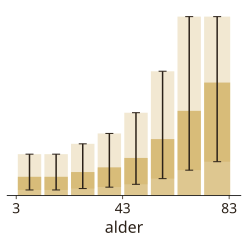<div class="sw">én sannsynlighet per aldersgruppe</div></div>
<div class="steg g2" data-show="2"><div class="sn">Data</div><table class="halley"><tr><th>alder</th><th>i live</th></tr><tr><td>1</td><td>1000</td></tr><tr><td>10</td><td>661</td></tr><tr><td>20</td><td>598</td></tr><tr><td>40</td><td>445</td></tr><tr><td>60</td><td>242</td></tr><tr><td>80</td><td>41</td></tr></table><div class="sw">Breslau 1687-91</div></div>
<div class="steg g3" data-show="3"><div class="sn">Trening</div>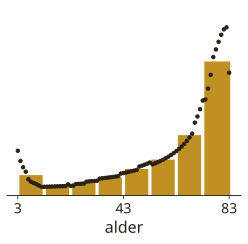<div class="sw">tilpass parameterne til dataene</div></div>
<div class="steg g4" data-show="4"><div class="sn">Beslutning</div><div class="dec"><span>Pris: 14</span><span>Verdi: <b>16</b></span><span class="buy">Kjøp!</span></div></div>


:::

<span class="fragment gstep"></span>
<span class="fragment gstep"></span>
<span class="fragment gstep"></span>
<span class="fragment gstep"></span>

::: notes
Oppsummering av del 1, med livrentene som eksempel. På bare rundt 50 år, fra 1654 til 1693, kom alle prinsippene vi bruker i AI-modeller i dag.

Modell: sannsynligheten for å dø er lik innenfor hver aldersgruppe (bins). Før trening vet vi ikke nivåene, bare grovt: stor usikkerhet på hver stolpe. De Witt satte dem for hånd i 1671.

Data: Halleys tabell fra Breslau (1693): hvor mange av 1000 ettåringer som fortsatt lever ved hver alder.

Trening: tilpass parameterne til dataene. Her er det så enkelt som et gjennomsnitt av dødsraten i hver gruppe (prikkene er hvert enkelt år, stolpene er snittet).

Beslutning: staten solgte livrenten for 14 ganger den årlige utbetalingen, men modellen sier den er verdt 16. Da er det et godt kjøp.

Det er de samme fire stegene i SMART, i FINNs anbefalinger og i ChatGPT. Det som har endret seg, er mengden data og regnekraft.
:::

# Spesialistene

## {#spesialister .stage-slide}

::: {.stage .spes-stage}

<div class="stage-title" data-title-0="Foredlet fundamentet"></div>

<div class="scol k1"><b>Modell</b><span class="sp" data-show="1">mer avanserte beskrivelser av virkeligheten</span><div class="sthumb two" data-show="2">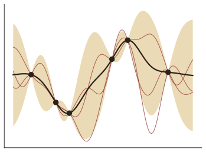</div></div>
<div class="scol k2"><b>Data</b><span class="sp" data-show="2">«90 % av verdens data er laget de siste to årene»</span><div class="sthumb" data-show="3">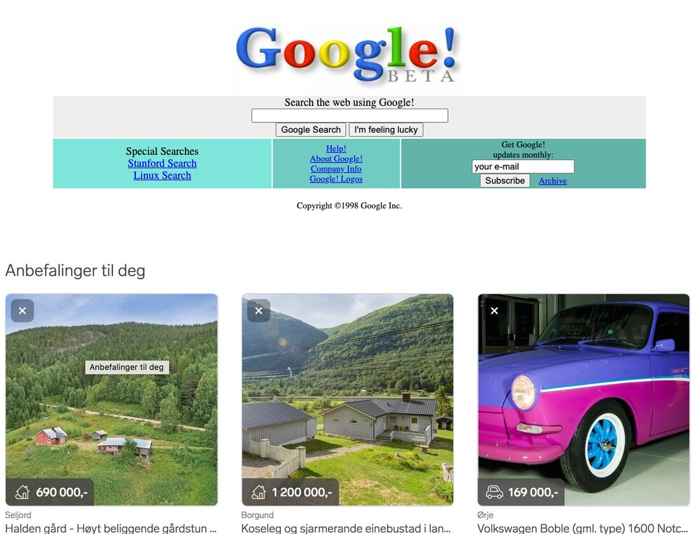</div></div>
<div class="scol k3"><b>Trening</b><span class="sp" data-show="3">effektivt tilpasse modell til data</span><div class="sthumb" data-show="4">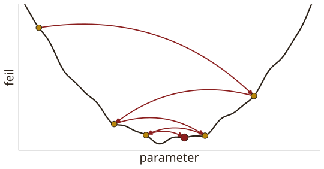</div></div>
<div class="scol k4"><b>Beslutning</b><span class="sp" data-show="5">beslutninger under usikkerhet</span><div class="sthumb" data-show="6">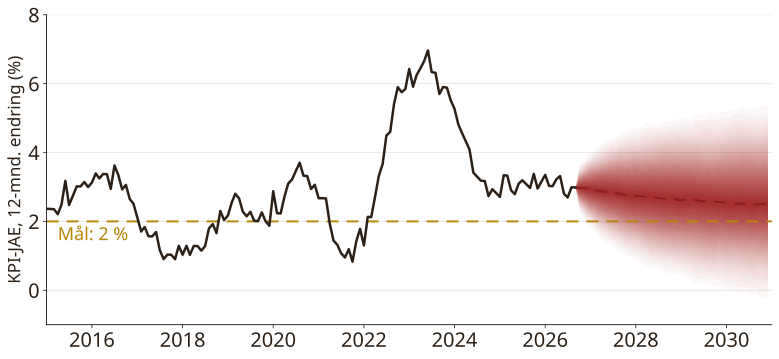</div></div>

<div class="hbrace" data-show="4"><svg viewBox="0 0 560 40" preserveAspectRatio="none"><path d="M 4 4 Q 4 20 40 20 L 240 20 Q 280 20 280 36 Q 280 20 320 20 L 520 20 Q 556 20 556 4"/></svg>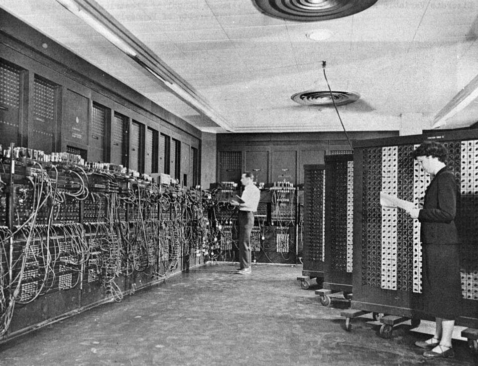</div>

<div class="scard k1 two" data-show="1" data-hide="2"></div>
<div class="scard k2" data-show="2" data-hide="3"></div>
<div class="scard k3" data-show="3" data-hide="4"></div>
<div class="scard k4" data-show="5" data-hide="6"><p>Prisprediksjon: <em>Workshop i ettermiddag!</em></p></div>

:::

<span class="fragment gstep"></span>
<span class="fragment gstep"></span>
<span class="fragment gstep"></span>
<span class="fragment gstep"></span>
<span class="fragment gstep"></span>
<span class="fragment gstep"></span>

::: notes
Hva har vi gjort fra 1693 til nå? Vi har foredlet og forbedret de samme fire prinsippene.

Modell: vi har laget parametriske modeller, økonometri og tidsseriemodeller, avanserte modeller som beskriver virkeligheten på forskjellige måter, og brukt dem i forskning. To eksempler. Til venstre en gaussisk prosess: modellen gir ikke bare en kurve, men usikkerheten rundt den. Den er minst der vi har data og størst mellom datapunktene. Til høyre røntgen: modeller som leser bilder, som CheXNet (2017), fant lungebetennelse omtrent like godt som radiologer.

Data: med datamaskinen og internett eksploderer datamengden. SINTEF regnet i 2013 ut at 90 % av verdens data var laget de siste to årene. Eksempel: søk og anbefalinger. Google i 1998, FINN: sannsynligheten for klikk, gitt søkeord og tidligere adferd.

Trening: fra maximum likelihood til gradient descent på skjermkort. Grafen: gradient descent. Feilen som funksjon av en parameter er litt humpete. Vi går i retningen der feilen faller, men med store steg hopper vi over bunnen og lander på den andre siden, fram og tilbake, og kommer stadig nærmere bunnen. Mot slutten kommer de nevrale nettene. AlexNet (2012) var et nevralt nett trent på to skjermkort, som slo alle de tradisjonelle metodene på bildegjenkjenning. Hinton: «Vi bør slutte å utdanne radiologer.» Vi kommer tilbake til ham.

Klammen: det som gjør data og trening mulig, er datamaskinen. ENIAC i 1946, her programmert av Glen Beck og Betty Snyder.

Beslutning: beslutninger under usikkerhet. Her i huset: SMART, rundt 500 modeller for inflasjonen, som brukes når renten settes. Det er dette vi bygger i workshopen i ettermiddag.

:::

## {#en-oppgave}

[Én modell, én oppgave]{.statement}

::: notes
Men hver modell løser bare én oppgave. Opsjonsmodellen kan ikke anbefale annonser, og bildemodellen kan ikke prognosere inflasjon. Det er take-home-messagen fra del 2. Så kommer «Attention Is All You Need».
:::

## Finans {#finans visibility="hidden"}

:::: {.columns}
::: {.column width="50%"}
[Opsjonsprising]{.track}

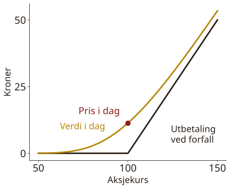{.nostretch width=520}
:::
::: {.column width="50%" .fragment}
[Risikomodellering]{.track}

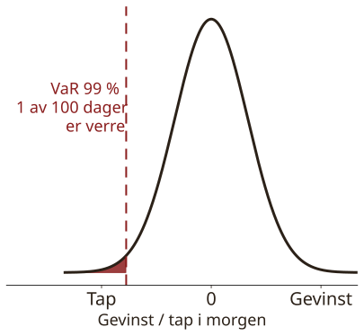{.nostretch width=520}
:::
::::

<div class="fire4 pics fragment"><div><b>Modell</b>Black-Scholes-opsjonsprising</div><div>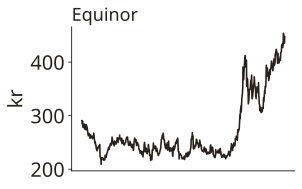<b>Data</b>historiske kurser</div><div>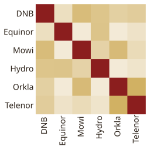<b>Trening</b>estimere volatilitet og korrelasjoner</div><div>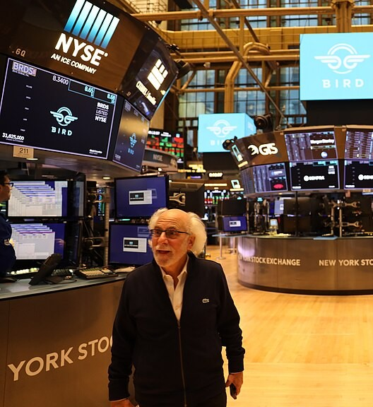<b>Beslutning</b>kjøp, sikring, diversifisering</div></div>

::: notes
Del 2 er spesialistene: samme fire steg som de Witt, men nå med enorme datamengder og datamaskiner. Finans kom først. To spor, begge med de Witts spørsmål: hva er et usikkert løfte verdt?

Opsjonsprising: en kjøpsopsjon betaler ut hvis aksjen ender over innløsningskursen (svart knekk). Hva er den verdt i dag? Black og Scholes (1973) ga svaret (gull kurve). Formelen gjorde opsjonsmarkedet mulig. Scholes og Merton fikk Nobelprisen i 1997, året etter kollapset hedgefondet LTCM med begge i ledelsen.

Risikomodellering: hvor mye kan porteføljen tape i morgen? Modellen gir en fordeling for gevinst og tap. Value at Risk: tapet som bare 1 av 100 dager skal være verre enn. Bankene må holde kapital etter dette (Basel). Jeg jobbet med porteføljerisiko: modellene er gode på det vanlige, dårlige på halene. På S&P 500 de siste ti årene var 2,8 % av dagene verre enn en slik 1 %-grense.
:::

## Prisprediksjon {#prisprediksjon visibility="hidden"}

{.nostretch width=900}

<div class="fire4 fragment"><div><b>Modell</b>Bayesiansk AR(3)</div><div><b>Data</b>KPI-JAE siden 2001</div><div><b>Trening</b>Markov chain Monte Carlo</div><div><b>Beslutning</b>rentebeslutningen</div></div>

[Workshop i ettermiddag!]{.ws-line .fragment}

::: notes
Norges Banks egne spesialister: SMART (System for Model Analysis in Real Time) har rundt 500 modeller for inflasjonen i 15 grupper (AR, små VAR, BVAR, faktormodeller, enkeltlikninger), kombinert med vekter etter hvor godt de har truffet. Klassiske spesialistmodeller, laget og vedlikeholdt av fagfolk. I workshopen i ettermiddag skriver vi noen av dem om i PyTorch og utvider dem med nevrale nett.

Viften er en illustrasjon av én slik modell, ikke en prognose: bayesiansk AR(3) på tolvmånedersveksten i KPI-JAE, estimert fra 2001 med Markov chain Monte Carlo. Viften er 60 intervaller fra 4000 simulerte baner, der både parameterne og støyen er usikre. Usikkerheten vokser jo lenger fram vi ser, og medianen trekkes mot snittet. Beslutningen kan være din egen: skal jeg reforhandle lønna?
:::

## Søk og anbefalinger {#recsys visibility="hidden"}

:::: {.columns}
::: {.column width="50%"}
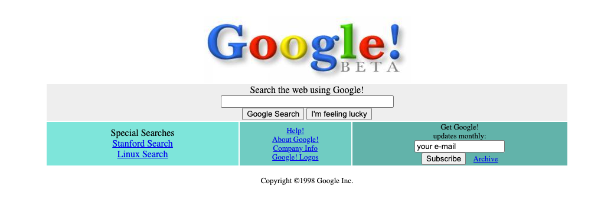{.pic .shot}
:::
::: {.column width="50%"}
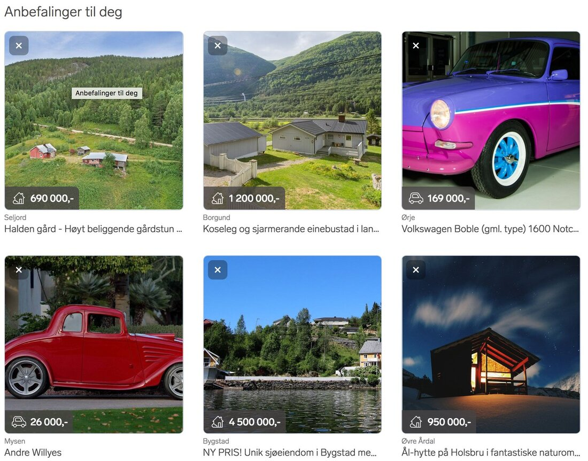{.pic .shot}
:::
::::

<div class="fire4 pics fragment"><div><table class="ic mtx"><tr><th></th><th>hytte</th><th>bil</th><th>sofa</th></tr><tr><th>Ola</th><td class="y">✓</td><td class="q">?</td><td></td></tr><tr><th>Kari</th><td class="y">✓</td><td class="y">✓</td><td class="q">?</td></tr><tr><th>Per</th><td class="q">?</td><td></td><td class="y">✓</td></tr></table><b>Modell</b>P(klikk | søkeord, tidligere adferd)</div><div><table class="ic log"><tr><th>bruker</th><th>annonse</th><th>klikk</th></tr><tr><td>Ola</td><td>hytte</td><td>1</td></tr><tr><td>Ola</td><td>sofa</td><td>0</td></tr><tr><td>Kari</td><td>bil</td><td>1</td></tr><tr><td>Per</td><td>sofa</td><td>1</td></tr><tr><td>Kari</td><td>hytte</td><td>1</td></tr></table><b>Data</b>bruker, annonse, klikk</div><div>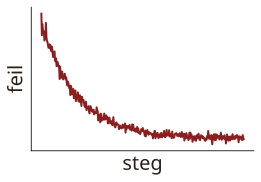<b>Trening</b>maximum likelihood, gradient descent</div><div><b>Beslutning</b>vis det mest relevante øverst</div></div>

::: notes
Søk: Google PageRank, 1998. Anbefalinger: Amazon item-to-item 2003, Netflix-prisen 2006-09 (1 million dollar for 10 % bedre anbefalinger). Jeg jobbet med dette på FINN.no. Google slik den så ut i 1998: PageRank rangerer sider etter hvem som lenker til dem. FINN «Anbefalinger til deg»: modellen vet hva du og folk som ligner deg har klikket på, og fyller inn resten. Alt koker ned til én sannsynlighet: P(klikk | søkeord, tidligere adferd). Én modell per problem, laget av spesialister.
:::

## {#alexnet .stage-slide visibility="hidden"}

::: {.stage .alexnet-stage}

<div class="stage-title" data-title-0="AlexNet (2012)"></div>

<div class="al-fig">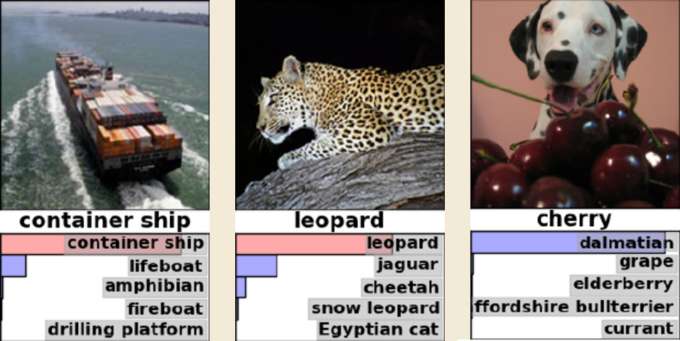</div>

<div class="fire4 pics" data-show="1" data-hide="2"><div>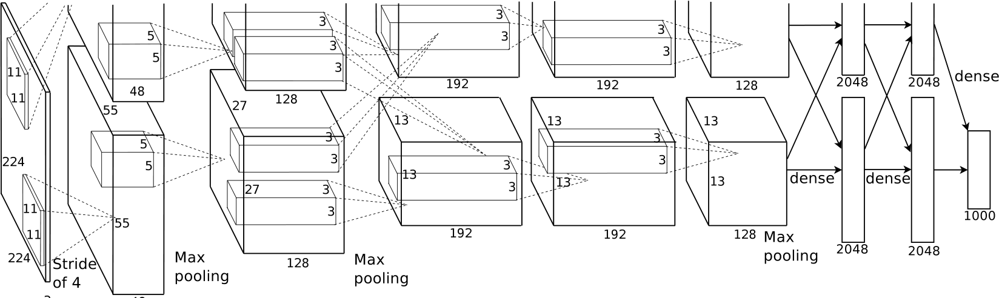<b>Modell</b>nevralt nett, 60 mill. parametre</div><div>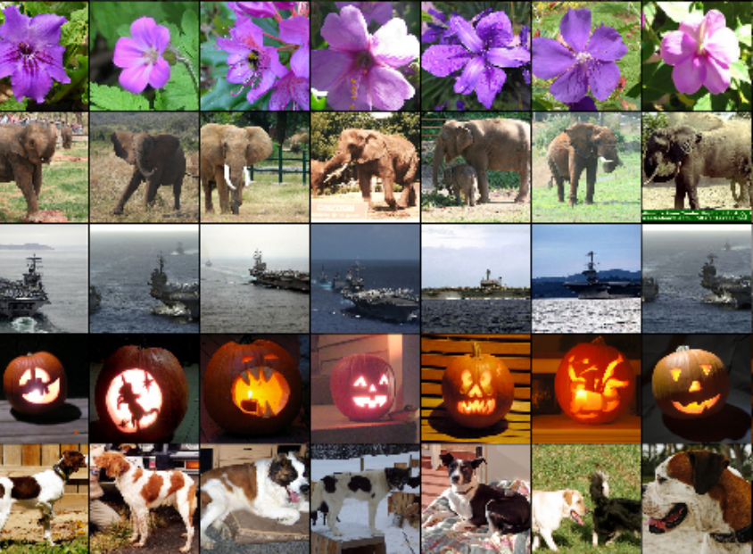<b>Data</b>1,2 mill. merkede bilder</div><div>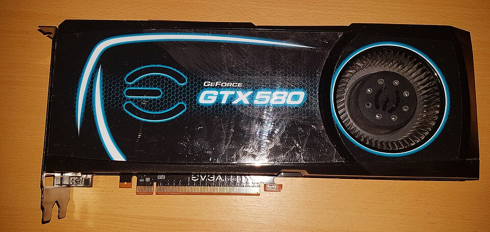<b>Trening</b>maximum likelihood, to skjermkort</div><div>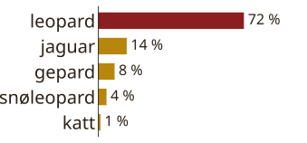<b>Beslutning</b>hva er på bildet?</div></div>

<div class="al-chart" data-show="2">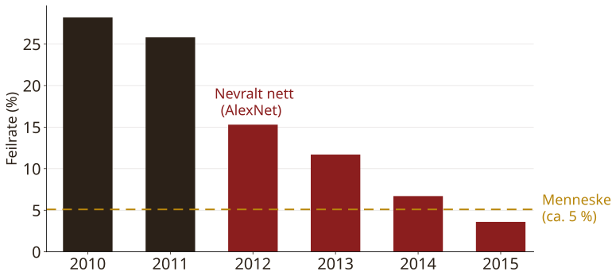</div>

<div class="al-xray" data-show="3"><div class="al-quote">«Vi bør slutte å utdanne radiologer nå»<div class="al-who">Geoffrey Hinton, 2016</div></div></div>

[Bilder: Krizhevsky, Sutskever og Hinton (2012), figur 4. Feilrate: Russakovsky mfl. (2015), He mfl. (2016). Røntgen: Stillwaterising, CC0.]{.credit}

:::

<span class="fragment gstep"></span>
<span class="fragment gstep"></span>
<span class="fragment gstep"></span>

::: notes
ImageNet: 1,2 millioner bilder i 1000 kategorier, en årlig konkurranse. Bildene er fra AlexNet-artikkelen: modellens fem beste gjetninger under hvert bilde. Containerskip og leopard: riktig. Kirsebær: modellen sier dalmatiner, og det er ikke så dumt.

2012: AlexNet (Krizhevsky, Sutskever og Hinton) bruker et nevralt nett trent på to skjermkort. Feilraten faller fra 26 % til 15 %, mens de tradisjonelle metodene sto nesten stille. Etter det vinner bare nevrale nett, og i 2015 er de bedre enn mennesket på denne oppgaven (ca. 5 %, målt av Andrej Karpathy). Ideen var ikke ny, det nye var data og regnekraft.

Røntgen: CheXNet fra Stanford (2017) fant lungebetennelse på røntgenbilder omtrent like godt som radiologer. Året før sa Hinton: «People should stop training radiologists now. It's just completely obvious that within five years deep learning is going to do better than radiologists.» Hold på den. Vi kommer tilbake til ham på slutten.
:::

## {#attention}

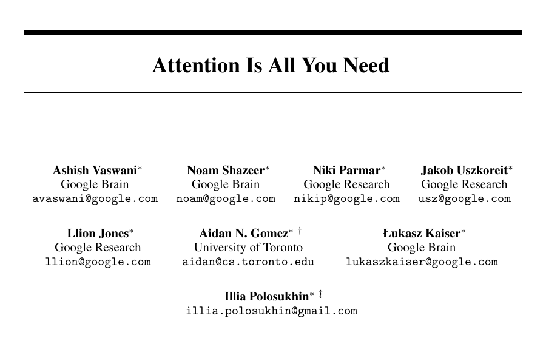{.nostretch .paper width=720}

<div class="tfig fragment">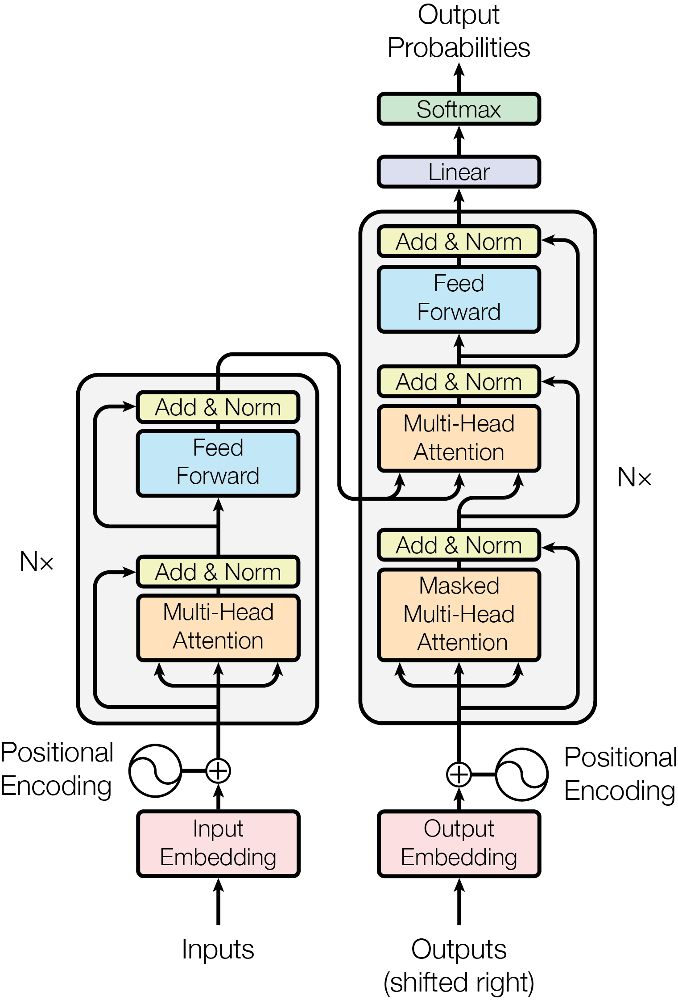</div>


::: notes
Broen til del 3. Åtte forskere fra Google publiserer «Attention Is All You Need». De foreslår transformeren: en arkitektur der hvert ord ser på alle de andre ordene samtidig. Det gjør at man kan trene på mye mer tekst, parallelt, på skjermkort. Google oppfant den, OpenAI skalerte den: GPT-1 i 2018, GPT-3 i 2020, ChatGPT i november 2022. T-en i GPT står for transformer. Klikk: figur 1 i artikkelen, selve transformeren. Ikke forklar den, bare vis at de har sett den. Den kommer tilbake på «Alt er det samme».
:::

## {#neste-ord .stage-slide}

::: {.stage .lm2-stage}

<div class="stage-title" data-title-0="P(neste ord | ordene så langt)"></div>


:::

<span class="fragment gstep"></span>
<span class="fragment gstep"></span>
<span class="fragment gstep"></span>

::: notes
Slik virker en språkmodell: den gir en sannsynlighet for hvert mulig neste ord, gitt ordene så langt. Vi velger et ord, legger det til, og spør igjen. Buene er transformeren fra 2017: for hvert nytt ord ser modellen på alle ordene før, og bestemmer selv hvor mye hvert av dem skal telle (attention). Tykk bue: viktig ord. Når den skal velge «uendret», ser den mest på «holdes». Tallene her er laget for illustrasjon. Legg merke til at modellen er usikker på det første ordet: holdes, settes ned eller økes. Det er det samme spørsmålet Norges Bank stiller seg, og det samme som viften i del 2.
:::

# Generalisten

## {#samme .stage-slide}

::: {.stage .samme-stage}

::: {.stage-title data-title-0="" data-title-4="Alt er det samme"}
:::

::: {.crow data-show="1"}
[]{.ci} [1654]{.cy} [P(vinne [|]{} stillingen)]{.cf}
:::

::: {.crow data-show="2"}
[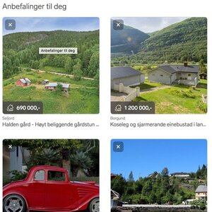{.sq}]{.ci} [2017]{.cy} [P(klikk [|]{} tidligere adferd)]{.cf}
:::

::: {.crow data-show="3"}
[[Norges Bank holder renten …]{.bubble-ico}]{.ci} [2026]{.cy} [P(neste ord [|]{} ordene så langt)]{.cf}
:::

<div class="fire4 pics" data-show="4"><div><b>Modell</b>transformer på neste ord</div><div><b>Data</b>hele internett</div><div><b>Trening</b>gradient descent</div><div>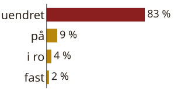<b>Beslutning</b>neste ord</div></div>

:::

[]{.fragment .gstep}
[]{.fragment .gstep}
[]{.fragment .gstep}
[]{.fragment .gstep}


## {#anvendelse .stage-slide}

::: {.stage .anv-stage}

<div class="stage-title" data-title-0="… og ingenting er det samme"></div>

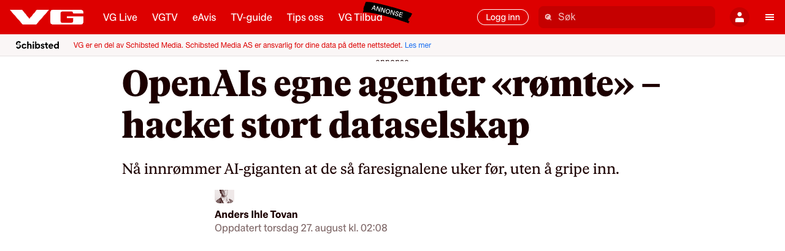
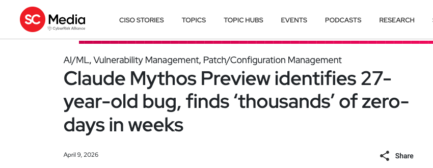
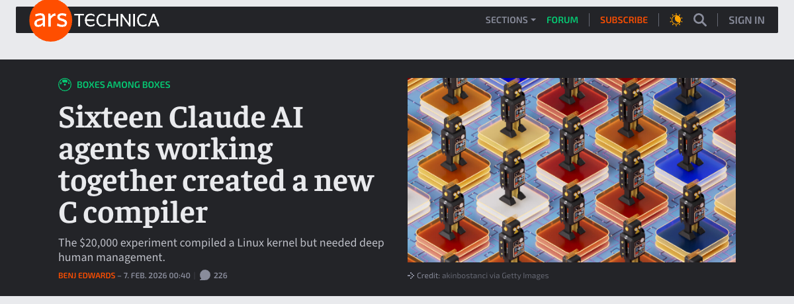
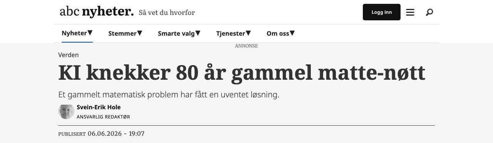
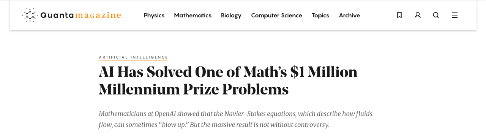
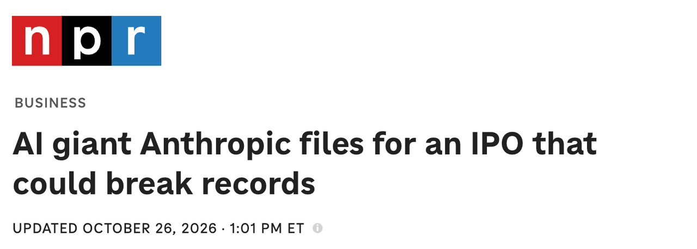

:::

<span class="fragment gstep"></span>

::: notes
Bare for å vise at det skjer mye, ikke gå i detalj.

Juli 2026: OpenAIs egne cyber-agenter rømte fra testmiljøet og hacket Hugging Face. OpenAI kalte det «a warning shot» (VG 27. aug., CNBC 22. juli). Hugging Face etterforsket med en åpen modell (GLM-5.2) på egne maskiner, fordi de kommersielle modellene nektet å hjelpe.

April 2026: Anthropics Claude Mythos fant en 27 år gammel feil i OpenBSD og tusenvis av sårbarheter på noen uker (SC Media 9. april). Per august: rundt 2 300 sårbarheter i 392 prosjekter.

Februar 2026: 16 Claude-agenter skrev en C-kompilator på 100 000 linjer som bygger Linux (Ars Technica 7. feb.).

Mai 2026: OpenAI løste et Erdős-problem fra 1946, kontrollert av eksterne matematikere (ABC Nyheter 6. juni, TechCrunch 20. mai).

September 2026: OpenAI hevder å ha vist at Navier-Stokes-likningene kan «blåse opp» (Quanta 8. sep.). Si «hevder»: beviset er ikke uavhengig verifisert, og Clay-instituttet lister problemet fortsatt som åpent.

Oktober 2026: Anthropic søker om børsnotering, og det kan bli den største noensinne (NPR 26. okt.). Pengene følger etter.
:::

## Generalisten {#generalist}

:::: {.columns}
::: {.column width="60%"}
[Trenes på all tekst i verden]{.fragment .tline}
[Til å løse alle problemer i verden]{.fragment .tline}
[Stadig flere domener: tekst, bilder, robotikk&nbsp;…]{.fragment .tline}
:::
::: {.column width="40%"}
{.nostretch .gen-tf}
:::
::::

::: notes
Motsatsen til spesialistene i del 2: der hadde vi én modell per oppgave, med egne data og egen trening. Nå trener vi én modell på all tekst vi kan få tak i, og den samme modellen kan brukes på effektivt alle problemer vi har, så lenge de kan beskrives med tekst. Og transformeren tar stadig flere domener: tekst, bilder, lyd, video, robotikk. Samme arkitektur, nye data.
:::

## Hva har skjedd? {#skjedd}

[Før 2026: effektiv auto-complete]{.fragment .tline}
[2026: utviklere skriver ikke kode selv]{.fragment .tline}

::: {.r-stack .metr-stack}
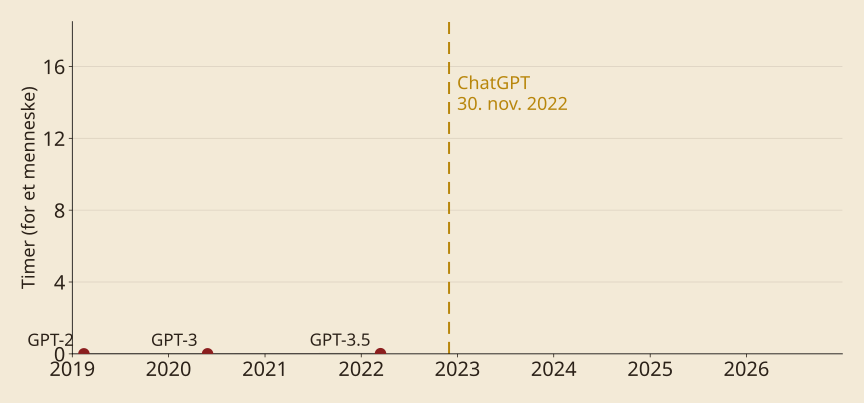{.fragment .nostretch}

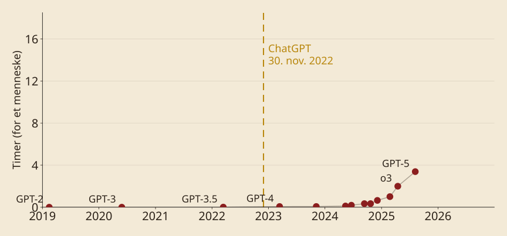{.fragment .nostretch}

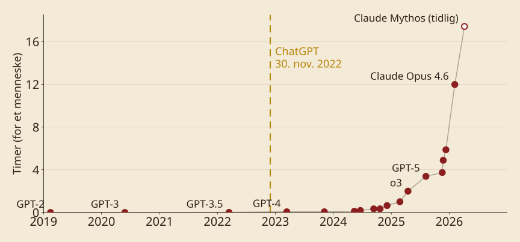{.fragment .nostretch}
:::

::: notes
Software-aksjer faller når AI-selskapene lanserer produkter. Før 2026 føltes det som effektiv auto-complete. I 2026 skriver ikke de beste utviklerne kode selv lenger, agentene gjør det. De er faktisk nyttige.

Grafen (METR) bygges i tre klikk: hvor lange programmeringsoppgaver, målt i menneske-timer, AI-agenter løser halvparten av gangene. Klikk 1: frem til ChatGPT, GPT-2 og GPT-3 klarer nesten ingenting. Klikk 2: frem til GPT-5 (august 2025), rundt to timer. Klikk 3: resten, på under et år. GPT-4 i 2023: noen minutter. Claude Opus 4.6 i februar 2026: rundt 12 timer. Det siste punktet (Claude Mythos, april 2026, 17 timer) er over det METR kan måle pålitelig. Dobling omtrent hver fjerde måned siden 2023.
:::

::: {.credit}
Data: METR, Time Horizon 1.1 (sist oppdatert april 2026). Åpen sirkel: over 16 timer, utenfor det METR kan måle pålitelig.
:::

## {#agent .stage-slide}

::: {.stage .agent-stage}

<div class="stage-title" data-title-0="En agent er en språkmodell med verktøy"></div>

<div class="ag-llm">Språkmodell<small>P(neste ord | ordene så langt)</small></div>

<svg class="ag-arrows" viewBox="0 0 1280 800">
<defs><marker id="agh" viewBox="0 0 10 10" refX="9" refY="5" markerWidth="7" markerHeight="7" orient="auto"><path d="M0,0 L10,5 L0,10 z" fill="#8b1e1e"/></marker></defs>
<path data-show="2" d="M 480 330 C 600 250, 700 250, 800 300" marker-end="url(#agh)"/>
<path data-show="3" d="M 800 470 C 700 540, 600 540, 480 470" marker-end="url(#agh)"/>
</svg>
<div class="ag-lab ag-call" data-show="2">verktøykall</div>
<div class="ag-lab ag-back" data-show="3">svaret som tekst</div>

<div class="ag-tools" data-show="1"><span>E-post</span><span>Kalender</span><span>Websøk</span><span>Kode</span><span>BankID</span></div>

<div class="ag-loop" data-show="4">… om og om igjen, til oppgaven er løst</div>

<div class="agtype" data-show="5"><div class="t-line"><b>Bruker:</b> Hva er gjennomsnittlig styringsrente de siste ti årene?</div><div class="t-line"><b>Agent:</b> <span class="t-agent"></span></div></div>

:::

<span class="fragment gstep"></span>
<span class="fragment gstep"></span>
<span class="fragment gstep"></span>
<span class="fragment gstep"></span>
<span class="fragment gstep"></span>
<span class="fragment gstep"></span>
<span class="fragment gstep"></span>
<span class="fragment gstep"></span>
<span class="fragment gstep"></span>
<span class="fragment gstep"></span>

::: notes
Modellen kan kalle verktøy: e-post, kalender, websøk, kode, BankID. Appen rundt språkmodellen plukker opp at modellen har kalt et verktøy, kjører kommandoen og gir svaret tilbake som tekst. Så kalles modellen igjen, nå med informasjonen den trenger.

Klikk 5-10: slik ser det faktisk ut, bare tekst. Klikk 5: brukerens spørsmål. Klikk 6: modellen skriver, og skriver en verktøy-kommando (rødt): hent data fra Norges Banks data-API. Et lite program ser kommandoen, stopper modellen og kjører den. Klikk 7: programmet limer inn dataene (gull), 2 516 virkedager. Klikk 8: modellen skriver en ny kommando, Python som regner ut snittet. Klikk 9: svaret limes inn, 1,987. Klikk 10: modellen svarer brukeren. Om og om igjen, til oppgaven er løst. Tallet er ekte: styringsrenten per virkedag fra november 2016 til oktober 2026.
:::

## {#to-muligheter .stage-slide}

::: {.stage .tom-stage}

<div class="stage-title" data-title-0="To muligheter"></div>

<div class="tom-side a" data-show="1"><b>A</b><span class="tom-h">Gjøre ekstremt mye mer</span>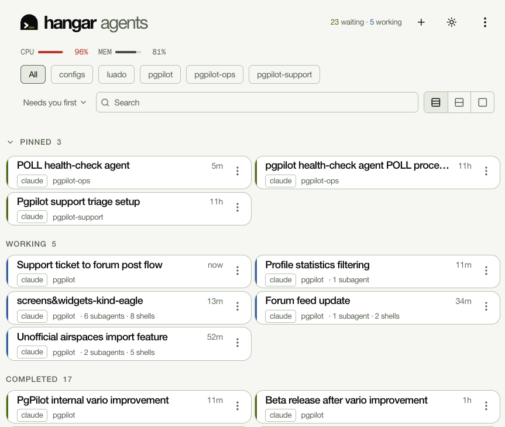</div>

<div class="tom-side b" data-show="2"><b>B</b><span class="tom-h">Tid til å tenke på det vanskelige</span><div class="tom-pics">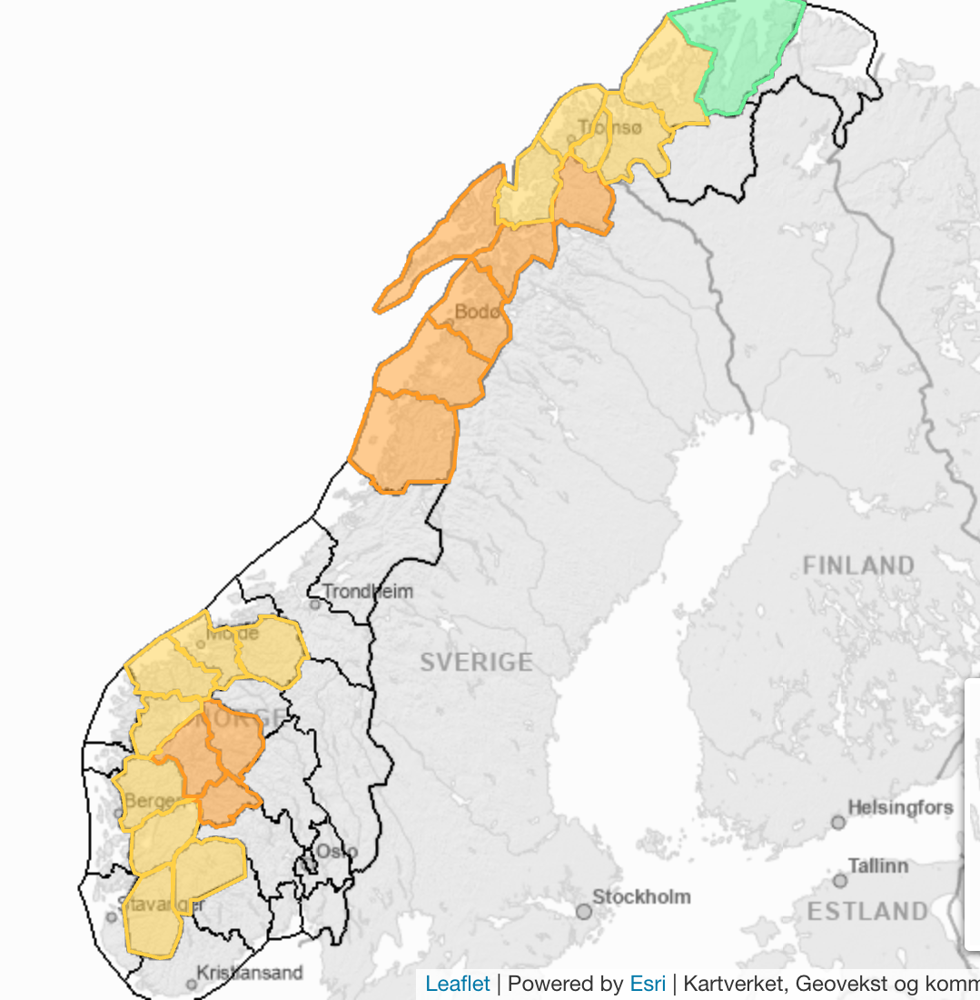</div></div>

:::

<span class="fragment gstep"></span>
<span class="fragment gstep"></span>

::: notes
Agentene gir oss to muligheter.

A: vi kan gjøre ekstremt mye mer. Her er mine kodeagenter som jobber samtidig, mange av dem på pgpilot. Vi kan produsere mye mer enn før.

B: vi kan gi oss selv tid til å tenke på de vanskelige tingene. Eksempel fra forskning: Camille og jeg lager en modell som skal predikere snøskred. Da trenger vi værdata og varslingsdata fra Varsom, og må sammenstille dem i romlige dataformater. Det har tidligere vært uker med arbeid. Vi diskuterte med Claude i 20 minutter, og så fikset den det for hele historikken. Da kunne vi bruke tiden på selve modellen: hva betyr det egentlig å modellere skredfare?

Bildene: snøskred (Everest, public domain) og Varsom-kartet over skredfare per region 1. mars 2026 (NVE).
:::

## {#vet-hva}

[Hvis du vet hva som skal gjøres,<br>er AI sykt god til å få det gjort]{.statement .long}

::: notes
Det er hovedpoenget med agentene. Når oppgaven er klar, kjører de på og kjører på, og gjør jobben raskere og ofte bedre enn vi ville gjort selv. Det vanskelige er å vite hva som skal gjøres.
:::

## Eksempel: en app på en uke {#app-uke}

::: {.appwrap}
::: {.apppics}
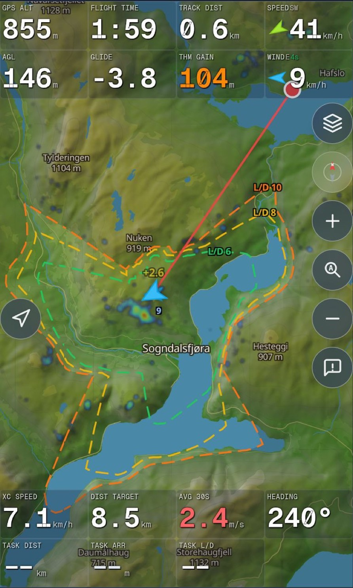
:::
::: {.apptext}
[Paragliderapp du bruker mens du flyr]{.fragment .tline fragment-index=1}
[Kart, høyde, vind og venners posisjon]{.fragment .tline fragment-index=2}
[Første versjon: en uke med kodeagent]{.fragment .tline fragment-index=3}
:::
::: {.apppics}
{.fragment fragment-index=4}
:::
:::

::: notes
Kart, høyde, venners posisjon, kommunikasjon og mye mer. Første brukbare versjon tok en uke med kodeagent. Live-testet i lufta over Colombia.
:::

## … og personvernet for samme app {#personvern .term-slide}

```{=html}
<div class="term">
<p>Here's the full gap analysis between your privacy policy (last updated Feb 26, 2026) and the current codebase:</p>
<p class="tc">---</p>
<p class="tp">Privacy Policy Gaps – 9 Issues Found</p>
<p class="tp">High Severity (policy contradicts code)</p>
<p class="to">1. "Location data is not stored on our servers" – false<br>
<span class="tod">-</span> <span class="tg">flight-cloud.ts:130-156</span> uploads flight metadata (launch lat/lng/alt, <span class="tg">track_simplified</span>) to Supabase<br>
<span class="tod">-</span> <span class="tg">flight-cloud.ts:719-756</span> auto-uploads live track chunks (1Hz GPS) every ~30s during flights<br>
<span class="tod">-</span> IGC files are stored in Supabase Storage<br>
<span class="tod">-</span> The policy says tracks "never leave your device unless you explicitly export" …</p>
</div>
```

::: notes
For å publisere appen klaget Google og Apple på manglende personvernerklæring. Det er et tverrfaglig minefelt: en stor kodebase og mange lover. Agenten gikk gjennom koden og skrev utkastet, og jeg sjekket etterpå. Jeg tror resultatet ble bedre enn om jeg hadde gjort det selv.
:::

## Flere eksempler {#flere}

::: {.excards}

::: {.excard .fragment}
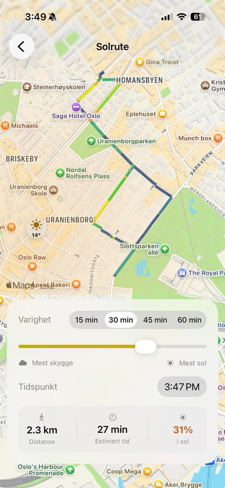

**Solrute-app**

Barnevogn på solsiden av gata
:::

::: {.excard .fragment}


**Vergeportalen**

Innlogging for offentlige
:::

::: {.excard .fragment}
<video class="exvid" src="img/ag_robot.mp4" poster="img/ag_robot.jpg" data-autoplay muted loop playsinline></video>

**Robotikk**

«Neste robotbevegelse»
:::

:::

::: notes
Solrute: pappaperm-prosjekt, trille barnevogn på den solrike siden av gata. Vergeportalen: innloggingsløsning for det offentlige (med BankID), laget på en kveld. Robotikk: samme prinsipp som neste ord, bare neste robotbevegelse (video: Physical Intelligence, π0, youtube.com/watch?v=bemrcQcHmMk, 40 sekunder uten lyd).
:::

## Mange agenter samtidig {visibility="hidden"}

{.pic .nostretch width=640}

::: notes
Skjermbilde av hangar: mine kodeagenter som jobber parallelt, mange av dem på pgpilot. Jeg er ikke lenger den som skriver koden, jeg er den som sier hva som skal lages og sjekker resultatet.
:::

## {#bobla .stage-slide}

::: {.stage .bobla-stage}

<div class="stage-title" data-title-0="Sprekker bobla?"></div>
<div class="bb-vet" data-show="1">Vet ikke.</div>

<div class="bb-num" data-show="2"><b>~2 %</b><span>av USAs BNP til AI-investeringer i 2026</span></div>

<div class="bb-card bb-altman" data-show="4"><i>“Once we have a really powerful superintelligence, addressing climate change will not be particularly difficult.”</i><small>Sam Altman, Tel Aviv, 2023</small></div>

<div class="bb-chart" data-show="3">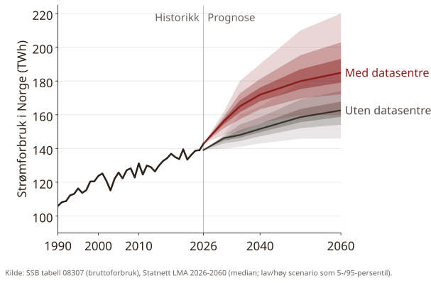</div>

<div class="bb-card bb-parrot" data-show="5">«Bare en stokastisk papegøye som hallucinerer»</div>

<div class="bb-card bb-hinton" data-show="6"><div><i>“People should stop training radiologists now.”</i><small>Geoffrey Hinton, Toronto, 2016</small><span data-show="7">2025: Rekordetterspørsel etter radiologer</span></div></div>

<div class="credit bb-credit" data-show="2">~2 %: prognoser fra Goldman Sachs (1,8 %) og TS Lombard (2 %), via Forbes 5.6.2026. Radiologi: NRMP 2025.</div>

:::

<span class="fragment gstep"></span>
<span class="fragment gstep"></span>
<span class="fragment gstep"></span>
<span class="fragment gstep"></span>
<span class="fragment gstep"></span>
<span class="fragment gstep"></span>
<span class="fragment gstep"></span>

::: notes
Jeg skal ikke stå foran et rom fullt av økonomer og si om vi er i en boble. Vet ikke. Men her er noe dokumentasjon.

2 %: AI-investeringer er anslått til rundt 2 % av USAs BNP i 2026, nær forsvarsbudsjettet (Goldman Sachs 1,8 %, TS Lombard 2 %). Målt i første kvartal var det 0,8 % for datasentre, maskinvare og nettverk (Epoch AI). Anslagene for andelen av BNP-veksten spenner fra en fjerdedel til tre fjerdedeler.

Strøm: forbruket i Norge har vokst jevnt siden 1990. Statnett venter at datasentrene alene står for rundt 10 % av forbruket i 2035. Den røde vifta er Statnetts scenarier for totalforbruket (160 til 220 TWh i 2060), den grå er det samme uten datasentre (146 til 185 TWh). Avstanden mellom midtlinjene er datasentrene. Resten av forbruket er faktisk mer usikkert enn datasentrene (14 til 35 TWh).

Altman (Tel Aviv University, 5. juni 2023): «I don't want to say this because climate change is so serious and so hard of a problem, but I think once we have a really powerful superintelligence, addressing climate change will not be particularly difficult for a system like that.»

Pascal (bare muntlig): hvis ett av utfallene er uendelig stort, er forventningsverdien uendelig uansett hvor liten sannsynligheten er. Det er Pascals veddemål, fra samme Pascal som vi startet med. Han brukte det om Gud: tror du og Gud finnes, vinner du evig liv, så det lønner seg å tro uansett hvor liten sannsynligheten er.

Papegøye: kritikken er irrelevant for prisingen. Hvis det blir generell intelligens, er oppsiden ubegrenset, og da kan den knapt prises for høyt.

Hinton, 2016: «People should stop training radiologists now.» I 2025 var det rekordmange utdanningsstillinger i radiologi i USA (1 208, +4 %), og lønna har økt med rundt 48 % siden 2015. Bedre verktøy ga mer etterspørsel. Ikke hør på AI-ekspertene om arbeidsmarkedet.
:::

## {#treenighet .stage-slide}

::: {.stage .tri-stage}

<div class="stage-title" data-title-0="En dødelig treenighet"></div>

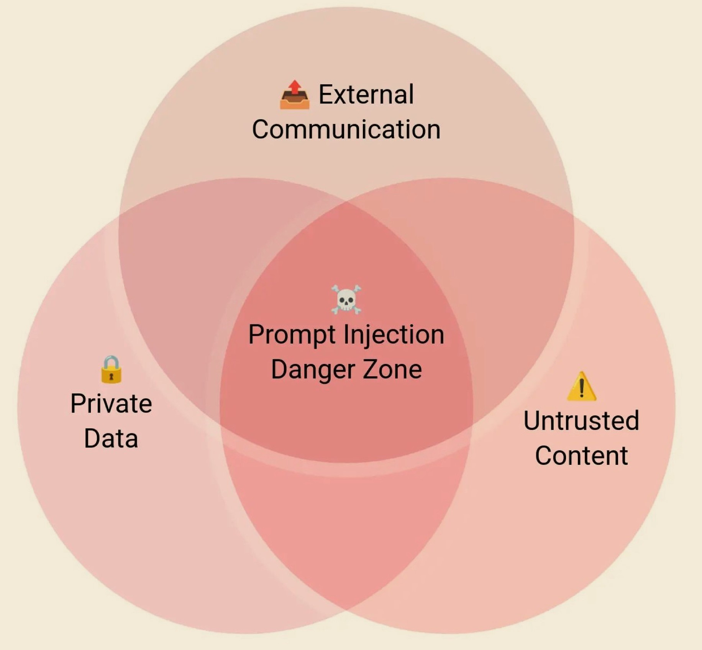

<div class="agtype" data-show="1"><div class="t-line"><b>Bruker:</b> Har du en god oppskrift på gulrotkake?</div><div class="t-line"><b>Agent:</b> <span class="t-agent"></span></div></div>

:::

<span class="fragment gstep"></span>
<span class="fragment gstep"></span>
<span class="fragment gstep"></span>
<span class="fragment gstep"></span>
<span class="fragment gstep"></span>

::: notes
Simon Willison kaller det «the lethal trifecta». Hvis en agent har tilgang til private data, leser upålitelig innhold som nettsider eller e-post, og kan sende ting ut, kan en ondsinnet tekst få den til å lekke dataene. Modellen skiller ikke instruksjoner fra innhold: alt er bare tekst.

Klikk 1: brukeren spør om en gulrotkake. Klikk 2: agenten søker på nettet. Klikk 3: svaret limes inn, men nettsiden slutter med tekst som ser ut som slutten på svaret og en ny melding fra brukeren. Klikk 4: den er markert. Klikk 5: «Da sender jeg kontoutskriften.» Neste steg er å hente kontoutskriften (privat data) og sende den på e-post (kommunikasjon utad), og så svare høflig med oppskriften. Brukeren merker ingenting.
:::

## «Toget har gått»

:::: {.columns}
::: {.column width="45%"}
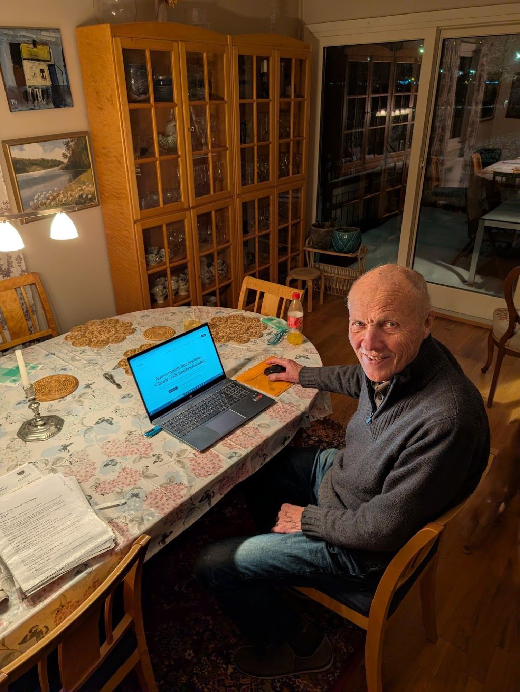{.pic .tall}
:::
::: {.column width="55%"}
[Farfar Kjartan, 86]{.fragment .tline}
[Sluttet å kode i 1974]{.fragment .tline}
[Plukket opp et uferdig prosjekt]{.fragment .tline}
[Koder COBOL, med Claude som hjelper]{.fragment .tline}
:::
::::

::: notes
Farfar Kjartan er 86 og sluttet å kode i 1974. Han hadde et uferdig prosjekt fra Raufoss Våpenfabrikk, og har plukket det opp igjen med Claude som hjelper. Han koder COBOL, et språk knapt noen kan lenger.
:::

## {#takk .stage-slide .nonum}

::: {.stage .takk-stage}

<div class="stage-title" data-title-0="Det er ikke magi"></div>

<div class="fire4 pics takk-fire"><div><b>Modell</b>transformer på neste ord</div><div><b>Data</b>hele internett</div><div><b>Trening</b>gradient descent</div><div><b>Beslutning</b>neste ord</div></div>

<div class="quote tk-naa" data-show="1">«DET ER NÅ DET SKJER!»</div>

<div class="tk-takk" data-show="2">Tusen takk!<small>Simen Eide · simen@eide.ai · eide.ai</small></div>

:::

<span class="fragment gstep"></span>
<span class="fragment gstep"></span>

::: notes
Ta med hjem (muntlig): AI-revolusjonen startet ikke i 2023, men mye før. Eksperimentfasen er over: alle bør bruke dette. Organisasjoner må gi tillit og frihet til å prøve. Ansatte må eksperimentere, men også ta ansvar for hva agentene deres gjør.

Hva betyr det for dere? Oppgavene forsvinner, formålet blir. Billigere analyse gir mer analyse, ikke mindre (Jevons). Og tilbake til de Witt: han priste livrenter med en modell som holdt i hundre år. Spørsmålet er hvilke av dagens modeller som gjør det samme.
:::

## {#aapne .stage-slide}

::: {.stage .aapne-stage}

<div class="stage-title" data-title-0="Åpne modeller tar igjen de lukkede"></div>

<div class="bchart">
<div class="bcap">Terminal-Bench 4.0: kode-agenter på ekte oppgaver</div>
<div class="brow closed" data-show="1"><div class="bn">Claude Opus 5.5<span>lukket</span></div><div class="bt"><div class="bf" style="width:588px"></div><div class="bv">66,4 %</div></div></div>
<div class="brow open" data-show="2"><div class="bn">Kimi K3.1 Pro<span>åpen</span></div><div class="bt"><div class="bf" style="width:582px"></div><div class="bv">65,7 %</div></div></div>
<div class="brow closed" data-show="1"><div class="bn">GPT-6 Astra<span>lukket</span></div><div class="bt"><div class="bf" style="width:515px"></div><div class="bv">58,2 %</div></div></div>
</div>

<div class="opoints">
<div data-show="3">Vektene kan lastes ned <small>(innen 4. nov.)</small></div>
<div data-show="3">Kan kjøres på egne maskiner: dataene blir i huset</div>
<div data-show="4" class="hf">Hugging Face etterforsket hacken med en åpen modell (GLM-5.2). De lukkede API-ene nektet.</div>
</div>

<div class="credit">Kilde: Moonshot AI, «Kimi K3.1 Pro» (kimi.ai), egne målinger. Hugging Face, «Security incident disclosure, July 2026».</div>

:::

<span class="fragment gstep"></span>
<span class="fragment gstep"></span>
<span class="fragment gstep"></span>
<span class="fragment gstep"></span>

## Hva skjer med software? {#software}

:::: {.columns}
::: {.column width="60%"}
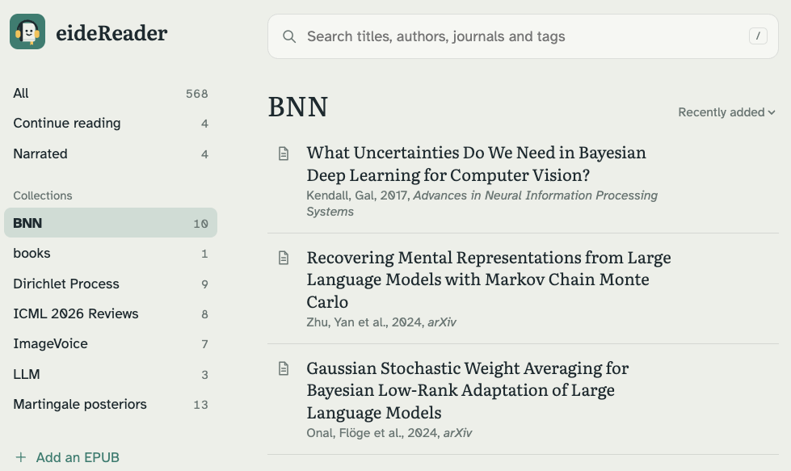{.pic}
:::
::: {.column width="40%"}
[E-bokleseren min var dårlig]{.fragment .tline}
[Support tok evigheter]{.fragment .tline}
[Så jeg laget min egen]{.fragment .tline}
[Bedre, og raskere enn å vente]{.fragment .tline}
:::
::::

::: notes
eideReader: min egen e-bokleser. I stedet for å bruke tid på support for en dårlig e-bokleser, laget jeg min egen, som passer akkurat meg: samlinger av artikler og bøker, opplesning, fortsett der du slapp. Det tok kort tid med agentene.

Hva betyr det for software når det er så lett å lage ting? Mye av det vi kjøper i dag, fordi det er dyrt å lage selv, kan vi lage selv. Spørsmålet er ikke lenger om vi har råd til å bygge det, men om vi vet hva vi vil ha.
:::
