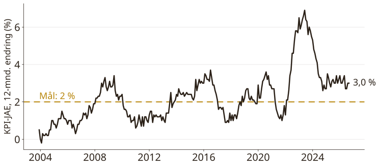
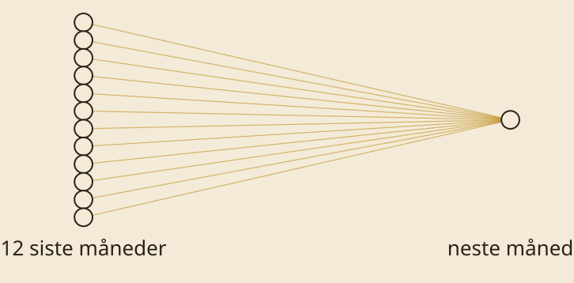
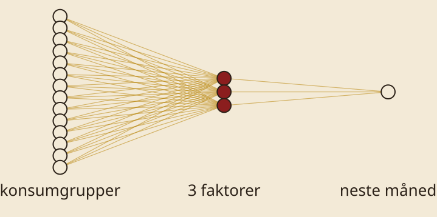
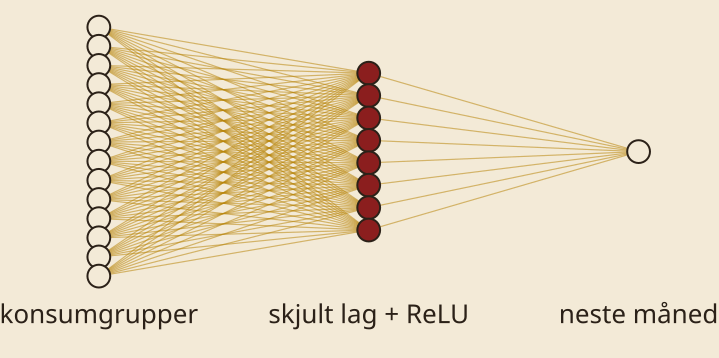

## Plan

- Intro
- Oppgave 1-2
- Pause
- Oppgave 3-4
- Prognose for oktober

::: notes
13:15 intro i 20-25 minutter. Oppgave 1 AR, oppgave 2 VAR og prior. Pause 14:30. Oppgave 3 faktormodell og nevrale nett, oppgave 4 fri konkurranse. Vi avslutter med at alle leverer en prognose for oktober-KPI, som SSB publiserer 10. november.
:::

## {.statement}

Data → Modell → Trening → Handling

::: notes
De fire stegene fra foredraget i morges. De Witt og Halley gjorde det samme i 1671 og 1693. I dag gjør vi det på KPI-JAE.
:::

## KPI-JAE

{width=1150}

::: notes
Data: KPI justert for avgiftsendringer og uten energivarer, 12-månedersendring. Ett datapunkt er en måned. KPI revideres ikke, så det vi ser i dag er det man visste den gangen. Derfor er priser et godt case. Oppgaven: gitt alt vi vet i dag, hva blir neste måned?
:::

## {.statement}

SMART: ~500 modeller

::: notes
Norges Bank prognoserer allerede KPI-JAE med rundt 500 statistiske modeller i SMART: AR, små VAR-modeller, faktormodeller, BVAR og Phillipskurve. De vektes etter hvor godt de har truffet, med mer vekt på nylige treff. Vi skal bygge noen av dem på nytt, og så gjøre dem om til nevrale nettverk.
:::

## Fra AR til nevralt nettverk

::: {.r-stack}
{width=1150}

{.fragment width=1150}

{.fragment width=1150}
:::

::: notes
AR-modellen: neste måned er en vektet sum av de 12 siste. Tegnet som et nettverk er det 12 noder inn, én ut, og vektene er strekene. Det er et nevralt nettverk med ett lag: nn.Linear(12, 1).

Klikk: faktormodellen. Mange serier komprimeres til noen få faktorer. Et skjult lag med få noder, en flaskehals.

Klikk: legg til ReLU i det skjulte laget, og vi har et ekte nevralt nettverk. Fra statistiske modeller til AI er et lite steg, ikke et sprang.
:::

## Treningsløkka

```python
for epoch in range(2000):
    optimizer.zero_grad()
    loss = ((model(x) - y) ** 2).mean()
    loss.backward()
    optimizer.step()
```

::: notes
Fem linjer. Regn ut hvor feil vi tar, finn hvilken vei vektene skal flyttes, flytt dem litt. Gjenta. For AR-modellen gir dette samme svar som OLS. Den samme løkka trener en språkmodell, bare med 10^11 parametere i stedet for 12.
:::

## Overtilpasning

- Trening: til 2016
- Validering: 2017-2020
- Test: 2021-

::: notes
Vi tester på måneder modellen aldri har sett, og testperioden inneholder inflasjonssjokket. En stor modell uten prior treffer historien og bommer på framtiden. En prior, weight decay eller en flaskehals hjelper. En BVAR-prior er det samme som regularisering. TODO: figur med trenings- og testfeil.
:::

## Oppgavene

1. AR
2. VAR + prior
3. Faktor + nevralt nett
4. Slå AR

::: notes
Colab-lenke kommer her, med QR-kode. File, Save a copy in Drive. Første celle laster data fra SSB og Norges Bank. Ledertavle: RMSE på testperioden.
:::

## {.statement}

Din prognose for oktober?

::: notes
SSB publiserer oktober-KPI 10. november. Alle leverer et tall, og vi ser hvem som traff.
:::
