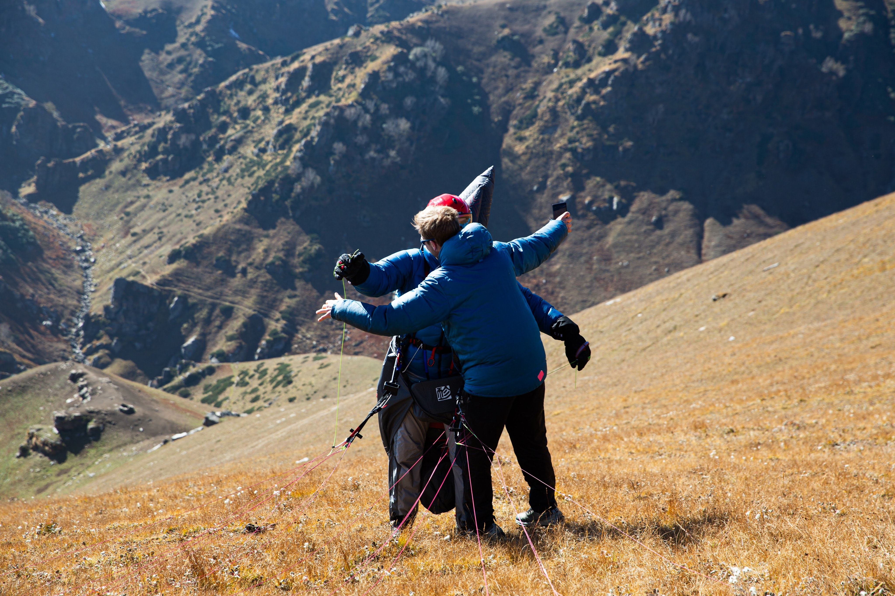

---
# Kortversjon av voss.qmd, ca. 15 minutter. Kuttlista og tidsbudsjettet ligger
# i KORT.md ved siden av. Gjenbruker voss.css, img/ og voss-video/.
title: "pgpilot og Himalaya"
subtitle: "Kortversjon, 15 min"
author: "Simen Eide"
lang: no
comments: false
html-math-method: plain
title-slide-attributes:
  data-visibility: hidden
resources:
  - voss-video/
  - img/poster-*.jpg
format:
  revealjs:
    theme: default
    css: voss.css
    slide-number: true
    width: 1280
    height: 720
    margin: 0
    transition: fade
    auto-stretch: false
    controls: true
    progress: true
    hash: true
    navigation-mode: linear
---

# Bli med på turen {.act-divider .hero-slide}

```{=html}
<div class="hero">
  
  
  <div class="hero-text">
    <p class="hero-kicker">pgpilot og India</p>
    <p class="hero-title">Bli med på turen</p>
  </div>
</div>
```

::: {.notes}
Ikke snakk her. Bildet gjør jobben, gå rett på "hvor er India?".

Grepet for hele kvarteret: vi tar av sammen og lander sammen, og appen dukker
opp fordi flyturen trenger den.
:::

## Hvor er India? Hvor er Bir?

```{=html}
<video class="fullbleed" src="voss-video/hvor-er-bir.mp4"
       poster="img/poster-hvor-er-bir.jpg"
       data-autoplay muted playsinline></video>
```

::: {.notes}
Klippet zoomer ut fra Voss og lander med Bir og Delhi i bildet. Ikke loop, la
sluttbildet stå: Bir ved foten av fjellkjeden, sletta under.

Hvorfor Bir, i én setning: sesong i oktober og april, en fjellkjede som ikke
tar slutt, og geit og te når du lander.
:::

## Hva er pgpilot?

```{=html}
<div class="two-up" style="align-items:flex-start; gap:44px; margin-top:112px">
  <div class="two-up-note">
    <p><strong>Instrumentet</strong></p>
    <p>Kart, vario, vind, luftrom og XC-poeng mens du flyr. Virker uten
    dekning.</p>
  </div>
  <div class="two-up-note">
    <p><strong>Sambandet</strong></p>
    <p>Snakk med hele gruppa over nettet, uten rekkevidde. VHF inn i samme
    kanal.</p>
  </div>
  <div class="two-up-note">
    <p><strong>Været</strong></p>
    <p>Vindmålere og varsel for startplassen, før du drar hjemmefra.</p>
  </div>
</div>
```

::: {.notes}
Under ett minutt. "Flyinstrumentet og Zello i én app, med været for
startplassen på kjøpet." Én setning per kolonne, ikke les opp.
:::

## Last ned

```{=html}
<div class="install">
  <div class="install-shot">
    
  </div>
  <div class="install-links">
    <div class="store">
      
      <div class="store-name">Android</div>
      <div class="store-sub">Google Play</div>
    </div>
    <div class="store">
      
      <div class="store-name">iPhone</div>
      <div class="store-sub">App Store</div>
    </div>
    <div class="store store-web">
      
      <div class="store-name">Eller bare</div>
      <div class="store-sub">pgpilot.app</div>
    </div>
  </div>
</div>
```

::: {.notes}
La denne stå lenge, det er en oppgave salen gjør mens du snakker.

Nettleserveien er redningen: pgpilot.app, visningsnavn og ingenting mer, ferdig
på et halvt minutt.

Første gang de åpner den spør appen om posisjon, mikrofon (bare mens knappen
holdes), enheter i nærheten og varsler. Si at data ikke selges. Be dem trykke
"See it in action", ikke Skip: den spiller av en ekte flytur og trenger verken
GPS eller utsikt.
:::

## Bli med i gruppa

```{=html}
<div class="joinbox">
  
  <div>
    <p class="join-url">pgpilot.app/join/<strong>voss</strong></p>
    <p class="join-sub">Skann, skriv navnet ditt, ferdig.</p>
  </div>
</div>
```

::: {.notes}
GRUPPA LAGES NÅR DU RIGGER, IKKE FØR. Reaperen arkiverer grupper som har vært
stille i fire timer, og da leder QR-koden til ingenting.

Si at de skal la appen ligge på, vi trenger dem i gruppa til vi lander.
:::

## Prat sammen

```{=html}
<div class="two-up">
  
  <video class="clip-sm" src="voss-video/klipp-talking.mp4"
         poster="img/poster-talking.jpg"
         data-autoplay loop muted playsinline></video>
</div>
```

::: {.notes}
ALLE LYTTER, ÉN SNAKKER. Du sier noe, og det kommer ut av alle telefonene i
rommet samtidig. Det er her de skjønner hva appen er.
:::

## Start fra Billing

```{=html}
<video class="clip" src="voss-video/klipp-start.mp4"
       poster="img/poster-start.jpg"
       data-autoplay playsinline></video>
```

::: {.notes}
Nå tar vi av, sammen. LYD PÅ: appens egen takeoff-lyd. Ikke snakk over de
første sekundene.

Si det rett ut: "Dette er ikke en video av flyturen, det er appen som flyr den
på nytt. Alt dere ser regnes ut mens sporet spilles av, akkurat som live."
:::

## Termikkboblen

```{=html}
<video class="clip" src="voss-video/klipp-termikk.mp4"
       poster="img/poster-termikk.jpg"
       data-autoplay loop muted playsinline></video>
```

::: {.notes}
Den mest overbevisende enkeltbiten. Varioen piper, appen tegner bobla, vindpila
strammer seg. Den vet ikke vinden når du tar av, den lærer den av sirklene
dine.
:::

## Du ser de andre

```{=html}
<video class="clip" src="voss-video/klipp-tracking.mp4"
       poster="img/poster-tracking.jpg"
       data-autoplay loop muted playsinline></video>
```

::: {.notes}
To piloter i samme boble. Det cyan sporet vokser mens klippet går. Det er
samme gruppe som dere nettopp ble med i.
:::

## Glide range på kartet

```{=html}
<video class="clip" src="voss-video/klipp-glide.mp4"
       poster="img/poster-glide.jpg"
       data-autoplay loop muted playsinline></video>
```

::: {.notes}
Konturene viser hvor langt du rekker: grønn L/D 6, gul 8, oransje 10. De
følger rygger og renner, ikke firkanter.

Still spørsmålet og la det henge: hvor langt er det til noe flatt? Så snur
historien.
:::

## Her mangler du tre ting

::: {.mangler .incremental}
- Internett
- Landinger
- Redning
:::

::: {.notes}
Vi har passert siste rygg, og nettet er dødt. Tre ord, én og én, langsomt.
Ingen varsel eller vindstasjoner, ingen flat mark, ingen som henter deg. Så du
flyr konservativt, med samband som virker, satellitt, og utstyr for en uke.
:::

## Hva pgpilot kan hjelpe deg med

```{=html}
<div class="two-up">
  <div class="two-up-note">
    <ul>
      <li>Se FLARM-buddies på kartet</li>
      <li>Koble InReach til kartet, så andre ser deg på pgpilot</li>
      <li>VHF direkte på mobilen</li>
    </ul>
  </div>
  
</div>
```

::: {.notes}
Det som står igjen uten nett: kartet i minnet, FLARM pilot til pilot, InReach
over satellitt, og VHF-broen som mikser radioprat inn i gruppa. I Himalaya
finnes knapt bakkestasjoner, så det er pilot til pilot som bærer.
:::

## Framme

```{=html}

```

::: {.notes}
Vi lander sammen. La bildet stå uten mye prat.
:::

## Og så, etterpå

```{=html}

```

::: {.notes}
Turen, bildene, segmentene og tallene på ett sted. IGC ut, automatisk
opplasting til Flightlog og XContest. Det er grunnen til at de åpner appen
igjen på tirsdag.
:::

## Sees vi?

```{=html}


<div class="sesong">Oktober og april</div>
```

::: {.notes}
Avslutt med en oppfordring, ikke en takk: appen er gratis, den ligger på
telefonen deres nå, og du vil ha tilbakemelding. Bir i oktober og april.
:::
