---
# Short version of tutorial.qmd, about 15 minutes, for a live evening at Bir
# Billing. The cut list and time budget are in TUTORIAL-KORT.md next to it.
# Reuses voss.css, img/ and voss-video/.
title: "pgpilot"
subtitle: "Short version, 15 min"
author: "Simen Eide"
lang: en
comments: false
html-math-method: plain
title-slide-attributes:
  data-visibility: hidden
resources:
  - voss-video/
  - img/
format:
  revealjs:
    theme: default
    css: voss.css
    slide-number: true
    width: 1280
    height: 720
    margin: 0
    transition: fade
    auto-stretch: false
    controls: true
    progress: true
    hash: true
    navigation-mode: linear
---

## Get started {.act-divider .hero-slide}

```{=html}
<div class="hero">
  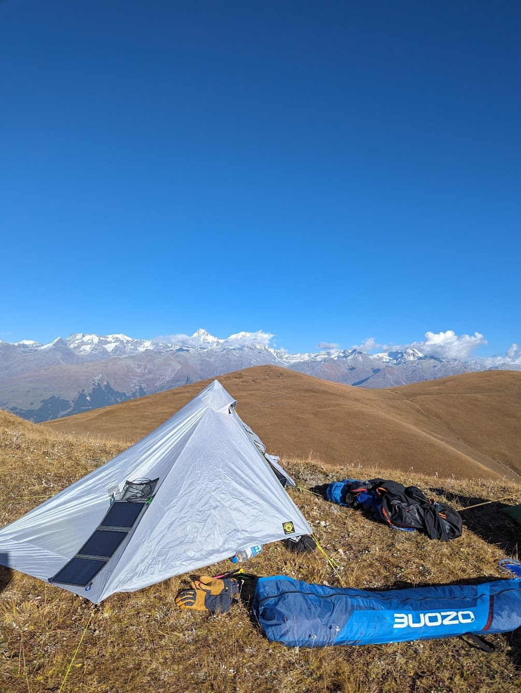
  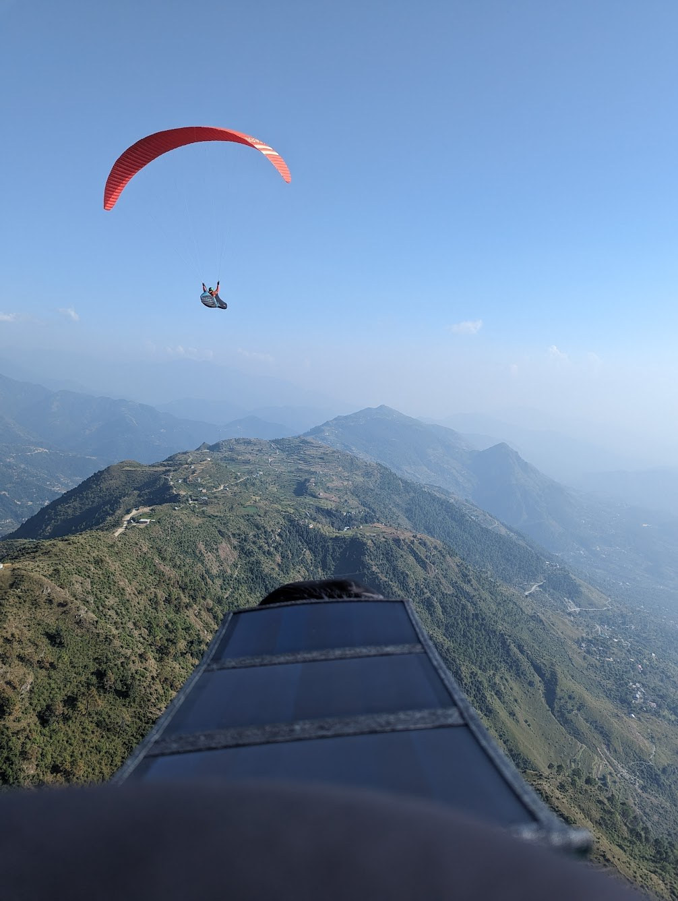
  <div class="hero-text">
    
    <p class="hero-kicker">Bir Billing</p>
  </div>
</div>
```

::: {.notes}
Ten seconds. The goal for the next quarter of an hour: everyone has the app on
the phone and on Local before they go to dinner. Do it with me as we go.
:::

## What is pgpilot? {.wide-slide background-image="img/app-inflight-wide.jpg" background-size="contain" background-color="#0f172a"}

```{=html}
<style>
  .wide-title { position:absolute; left:24px; bottom:26px; padding:10px 26px 14px; border-radius:16px; background:rgba(15,23,42,0.86);
                box-shadow:0 10px 30px rgba(0,0,0,0.45); font-family:"Bevan", Georgia, serif; font-size:46px; line-height:1.1; color:#fff; z-index:5; }
  .reveal .wide-slide > h2 { display:none; }
  .feature-pill {
    display: flex;
    align-items: center;
    gap: 0.6rem;
    width: fit-content;
    max-width: none;
    margin-inline: auto;
    padding: 0.46rem 0.9rem;
    background: #131b29;
    color: #eaf2fb;
    border: 1px solid rgba(73, 143, 205, 0.5);
    border-radius: 999px;
    font-size: 1em;
    line-height: 1.2;
    white-space: nowrap;
    box-shadow: 0 4px 12px rgba(0, 0, 0, 0.14);
  }
  .feature-pill::before {
    content: "";
    width: 8px;
    height: 8px;
    flex: none;
    border-radius: 50%;
    background: #38bdf8;
  }
  .wip-dim { position:absolute; inset:-60px; background:rgba(15,23,42,0.72); z-index:3; }
  .wip-grid { position:absolute; left:0; right:0; top:100px; bottom:120px; display:grid; grid-template-columns:repeat(3, 1fr); align-content:center; gap:18px 0; z-index:4; }
  .wip-grid > div { display:flex; flex-direction:column; gap:14px; }
  .wip-tag { position:absolute; left:0; right:0; top:22px; text-align:center; font-family:"Bevan", Georgia, serif; font-size:54px; line-height:1.1; color:#38bdf8; text-shadow:0 3px 16px rgba(0,0,0,0.6); z-index:4; }
</style>
<div class="fragment fade-in">
  <div class="wip-dim"></div>
  <div class="wip-tag">All in one app</div>
  <div class="wip-grid">
    <div>
      <div class="feature-pill">Flight instrument</div>
      <div class="feature-pill">Live wind</div>
      <div class="feature-pill">Airspace</div>
      <div class="feature-pill">Terrain</div>
    </div>
    <div>
      <div class="feature-pill">Group chat</div>
      <div class="feature-pill">VHF radio</div>
      <div class="feature-pill">Tracking</div>
      <div class="feature-pill">Offline</div>
    </div>
    <div>
      <div class="feature-pill">Weather</div>
      <div class="feature-pill">Task</div>
      <div class="feature-pill">Flight log</div>
      <div class="feature-pill">Replay</div>
    </div>
  </div>
</div>
<div class="wide-title">What is pgpilot?</div>
```

::: {.notes}
First the screen: this is me in the air over Bir today, with the others
around me. Click for the pills.

Under a minute. "The flight instrument and Zello in one app, with the weather
for takeoff on top." Point at the groups, don't read the pills.
:::

## Get the app

```{=html}
<div class="install">
  <div class="install-shot">
    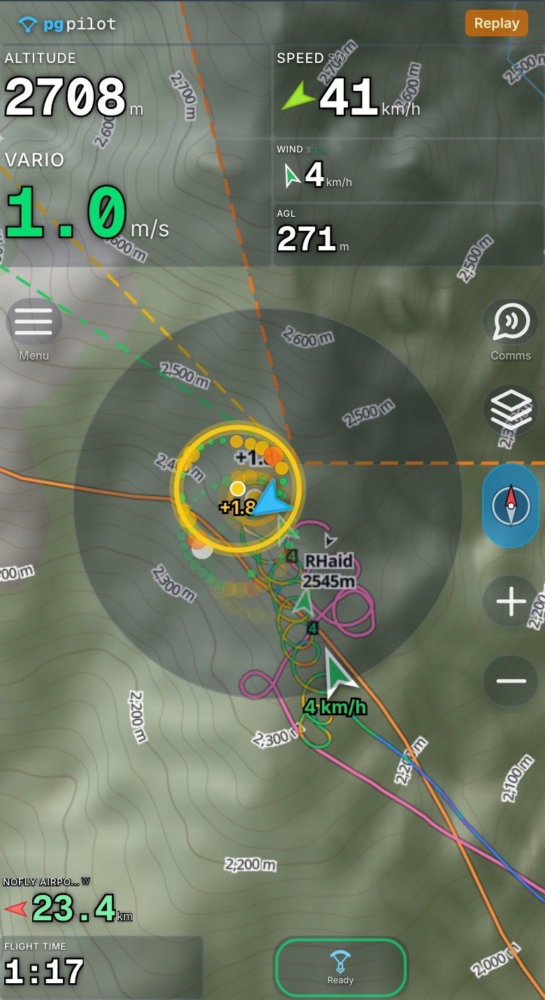
  </div>
  <div class="install-links">
    <div class="store">
      
      <div class="store-name">Android</div>
      <div class="store-sub">Google Play</div>
    </div>
    <div class="store">
      
      <div class="store-name">iPhone</div>
      <div class="store-sub">App Store</div>
    </div>
    <div class="store store-web">
      
      <div class="store-name">Or just</div>
      <div class="store-sub">pgpilot.app</div>
    </div>
  </div>
</div>
```

::: {.notes}
Leave this up while people do it. It's a task, not an illustration.

If the mobile data is slow, the rescue is pgpilot.app in the browser: a viewer
name and nothing more, done in half a minute. Everything tonight works there
except Bluetooth.
:::

## First time you open it

```{=html}
<div class="two-up" style="justify-content:center">
  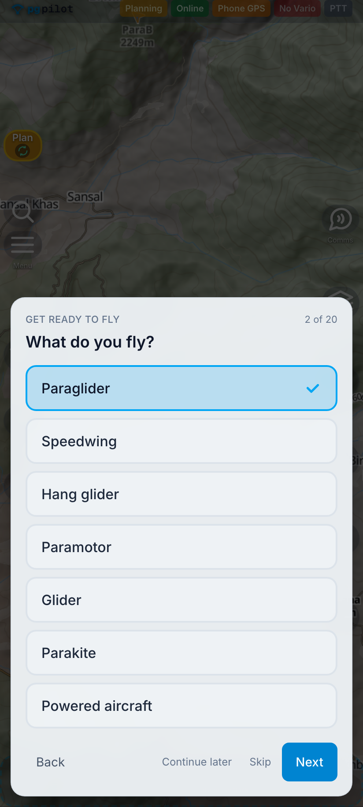
  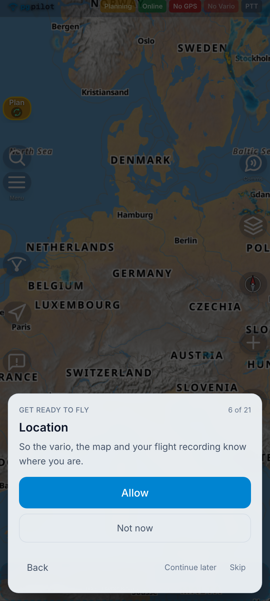
  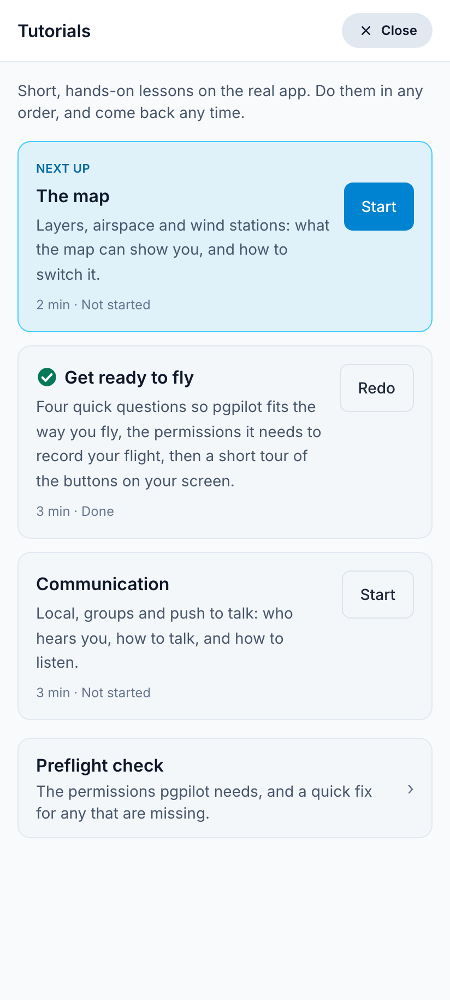
</div>
```

::: {.notes}
The first time you open pgpilot, a tutorial takes you through it. Four quick
questions: what you fly, what kind of flying, where your phone sits, and
whether you have your own vario. The answers pick your instrument layout and
whether pgpilot beeps as your vario.

Click. Then only the permissions your phone needs to record a flight, one at a
time, each with a reason: location, and on Android also always-on location,
notifications and battery. The microphone is asked the first time you talk.

Then a short tour of your screen: Plan and Active, the instruments, comms and
push to talk, map settings.

Click. Everything is in Menu, Tutorials, under Help. Do them in any order,
come back any time. Do "Get ready to fly" now if you skipped it.
:::

## In the air {.wide-slide background-video="voss-video/bir-air.mp4" background-video-loop="true" background-video-muted="true" background-size="contain" background-color="#0f172a"}

```{=html}
<style>
  .wide-title { position:absolute; left:24px; bottom:26px; padding:10px 26px 14px; border-radius:16px; background:rgba(15,23,42,0.86);
                box-shadow:0 10px 30px rgba(0,0,0,0.45); font-family:"Bevan", Georgia, serif; font-size:46px; line-height:1.1; color:#fff; z-index:5; }
  .reveal .wide-slide > h2 { display:none; }
</style>
<div class="wide-title">In the air</div>
<script>
(function () {
  // reveal.js races its own background-video start on slide change, so start
  // it here too, retrying until the element is present and playing.
  function playBg(tries) {
    var v = document.querySelector(".slide-background.present video");
    if (v) { v.muted = true; if (v.paused) { v.currentTime = 0; v.play().catch(function () {}); } }
    if (tries > 0 && (!v || v.paused)) { setTimeout(function () { playBg(tries - 1); }, 150); }
  }
  function hook() {
    if (!window.Reveal || !Reveal.isReady || !Reveal.isReady()) { return setTimeout(hook, 200); }
    function check() { var s = Reveal.getCurrentSlide(); if (s && s.id === "in-the-air") { setTimeout(function () { playBg(20); }, 50); } }
    Reveal.on("slidechanged", check);
    check();
  }
  hook();
})();
</script>
```

::: {.notes}
This is my flight today from Billing, replayed in the app, same code as live.
Gliding in, and you see the others around you with their altitude: Louis,
RHaider, Markus.

I hit the thermal and thermal assist switches on by itself: the bubble shows
where the lift is, and the map zooms in. Then I circle, and RHaider is in the
same climb with me.

None of these numbers come from the internet: GPS and the barometer in the
phone. 100 km triangle today, 4 h 48 min.
:::

## Talk together {.tt .wide-slide background-image="img/app-thermal-wide.jpg" background-size="contain" background-color="#0f172a"}

```{=html}
<style>
  .wide-title { position:absolute; left:24px; bottom:26px; padding:10px 26px 14px; border-radius:16px; background:rgba(15,23,42,0.86);
                box-shadow:0 10px 30px rgba(0,0,0,0.45); font-family:"Bevan", Georgia, serif; font-size:46px; line-height:1.1; color:#fff; z-index:5; }
  .reveal .wide-slide > h2 { display:none; }
  .tt-stack { position:absolute; left:50%; top:25%; transform:translateX(-50%); width:760px; display:flex; flex-direction:column; gap:14px; z-index:4; }
  .tt-ptt { position:absolute; right:250px; bottom:24px; width:150px; height:150px; border-radius:26px; border:3px solid rgba(255,255,255,0.35);
            background:rgba(30,41,59,0.72); backdrop-filter:blur(6px); display:flex; flex-direction:column; align-items:center; justify-content:center; gap:8px;
            color:#fff; box-shadow:0 10px 30px rgba(0,0,0,0.45); transition:background .25s, border-color .25s; z-index:5; }
  .tt-ptt svg { width:58px; height:58px; }
  .tt-ptt .tt-ptt-label { font-size:20px; font-weight:600; max-width:136px; white-space:nowrap; overflow:hidden; text-overflow:ellipsis; }
  .tt-ptt .ring { position:absolute; inset:-3px; border-radius:26px; pointer-events:none; opacity:0; }
  .tt-ptt.talking { background:#dc2626; border-color:#fca5a5; }
  .tt-ptt.talking .ring { opacity:1; border:4px solid #fca5a5; animation:ttping 1.1s cubic-bezier(0,0,.2,1) infinite; }
  .tt-ptt.incoming { background:rgba(22,163,74,0.78); border-color:rgba(74,222,128,0.8); }
  .tt-ptt.incoming .ring { opacity:1; border:3px solid #4ade80; animation:ttpulse 1.2s ease-in-out infinite; }
  @keyframes ttping { 0%{transform:scale(1); opacity:.9} 100%{transform:scale(1.35); opacity:0} }
  @keyframes ttpulse { 0%,100%{opacity:.25} 50%{opacity:.9} }
  .tt-toast { background:rgba(14,116,144,0.95); color:#fff; border-radius:18px; padding:18px 26px 16px; box-shadow:0 14px 40px rgba(0,0,0,0.45);
              opacity:0; transform:translateY(-14px); transition:opacity .35s ease, transform .35s ease; }
  .tt-toast.on { opacity:1; transform:none; }
  .tt-toast.old { background:rgba(21,94,117,0.97); color:#d5eef5; }
  .tt-msg { font-size:34px; line-height:1.25; min-height:1.25em; font-weight:600; }
  .tt-sub { margin-top:6px; font-size:20px; color:#cffafe; display:flex; align-items:center; gap:10px; }
  .tt-wave { display:inline-flex; gap:4px; align-items:center; height:22px; }
  .tt-wave i { width:4px; height:8px; background:#a5f3fc; border-radius:2px; animation:ttw 0.9s ease-in-out infinite; }
  .tt-wave i:nth-child(2){animation-delay:.15s} .tt-wave i:nth-child(3){animation-delay:.3s} .tt-wave i:nth-child(4){animation-delay:.45s} .tt-wave i:nth-child(5){animation-delay:.6s}
  @keyframes ttw { 0%,100%{height:6px} 50%{height:22px} }
  .tt-toast.done .tt-wave { display:none; }
</style>
<div class="wide-title">Talk together</div>
<div class="tt-stack"></div>
<div class="tt-ptt"><span class="ring"></span>
  <svg viewBox="0 0 24 24" fill="none" stroke="currentColor" stroke-width="2"><rect x="9" y="2" width="6" height="12" rx="3"/><path d="M5 10a7 7 0 0014 0"/><line x1="12" y1="17" x2="12" y2="21"/></svg>
  <span class="tt-ptt-label">Local</span>
</div>
<script>
(function () {
  var lines = [
    ["Topping out at 3,450 over the spine, highest yet today!", "Andreas · 11:42"],
    ["Coming over, I'm at 2,600 just above takeoff.", "RHaider · 11:43"],
    ["Bombed out near Mandi, horrible landing.", "Simen · 14:47", "me"]
  ];
  var timers = [];
  function clear() { timers.forEach(clearTimeout); timers = []; }
  function at(ms, fn) { timers.push(setTimeout(fn, ms)); }
  function play(slide) {
    clear();
    var stack = slide.querySelector(".tt-stack");
    var ptt = slide.querySelector(".tt-ptt"), label = ptt.querySelector(".tt-ptt-label");
    function setPtt(state, text) { ptt.classList.remove("talking", "incoming"); if (state) { ptt.classList.add(state); } label.textContent = text; }
    setPtt(null, "Local");
    stack.innerHTML = "";
    var t = 600;
    lines.forEach(function (l) {
      var el = document.createElement("div");
      el.className = "tt-toast";
      el.innerHTML = '<div class="tt-msg"></div><div class="tt-sub"><span class="tt-wave"><i></i><i></i><i></i><i></i><i></i></span><span>' + l[1] + '</span></div>';
      var mine = l[2] === "me";
      at(t - 500, function () { setPtt(mine ? "talking" : "incoming", mine ? "Talking" : l[1].split(" · ")[0]); });
      at(t, function () {
        stack.querySelectorAll(".tt-toast").forEach(function (o) { o.classList.add("old"); });
        stack.appendChild(el);
        requestAnimationFrame(function () { el.classList.add("on"); });
      });
      t += 900;
      var words = l[0].split(" ");
      words.forEach(function (w, i) {
        at(t + i * 230, function () { el.querySelector(".tt-msg").textContent = words.slice(0, i + 1).join(" "); });
      });
      t += words.length * 230 + 300;
      at(t, function () { el.classList.add("done"); setPtt(null, "Local"); });
      t += 1600;
    });
  }
  function hook() {
    if (!window.Reveal || !Reveal.isReady || !Reveal.isReady()) { return setTimeout(hook, 200); }
    function check() { var s = Reveal.getCurrentSlide(); if (s && s.classList.contains("tt")) { play(s); } else { clear(); } }
    Reveal.on("slidechanged", check);
    check();
  }
  hook();
})();
</script>
```

::: {.notes}
EVERYONE LISTENS, ONE TALKS. Press the button, talk, and it comes out of every
phone on Local around us at once, no range limit. And it's written out on screen, so
you can read it without listening back.

Ask a volunteer to press and talk now. This is the moment they get it.

A button on the riser does the same with gloves on.
:::

## Airgram for Billing

```{=html}
<div class="two-up" style="justify-content:center">
  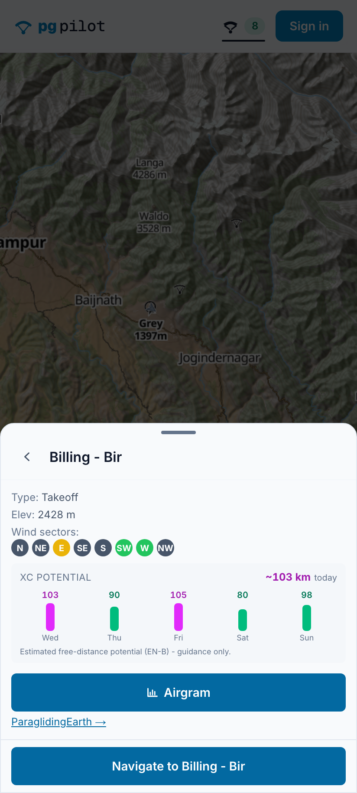
  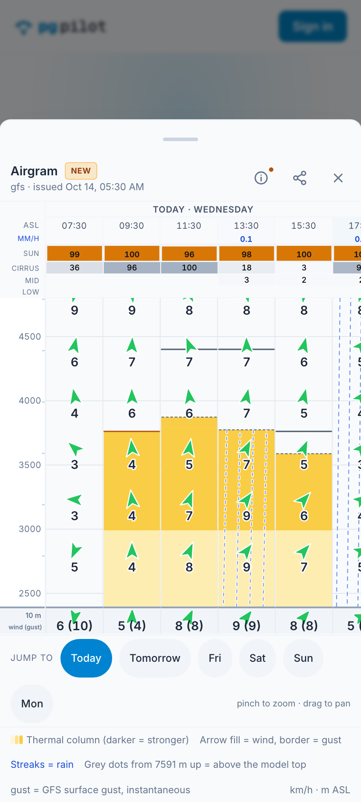
  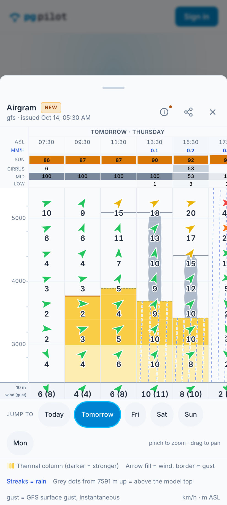
</div>
```

::: {.notes}
Tap the Billing takeoff on the map and you get the takeoff card. Wind sectors from
ParaglidingEarth: south-west and west are the good ones here. And XC potential
for the week: it said about 103 km today, and five of us flew between 100 and
131 km. Estimate for an EN-B wing, guidance only.

Click. Open the airgram. Yellow columns are thermals, darker is
stronger, the top is how high you get. Wind arrows up through the heights,
cloud and rain on top. Here the model is GFS, the only one that covers India.

Today: a classic blue day. Light upslope wind from the south-west, thermals
from about half past nine to half past four, up to around 3,800 m.

And how did it do? The best anyone got today was 3,466 m, Andreas, and most of
us topped out around 3,000 to 3,300. GFS is coarse in these mountains, so read
the top as a ceiling, not a promise. The distance was spot on, though.

Click. Tomorrow: high cloud in the morning, cumulus from about half past one
with bases around 3,500 m, more wind up high and a small chance of a shower in
the afternoon.
:::

## After the flight

```{=html}
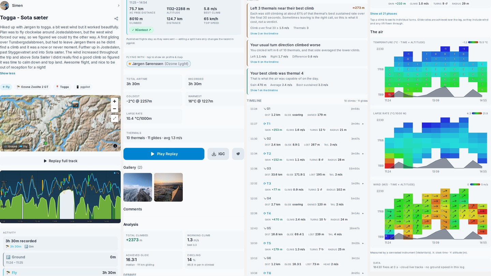
```

::: {.notes}
Track, photos, segments, numbers. IGC out, and under Menu, Connected services,
automatic upload to XContest and Flightlog. Nobody uploads by hand any more.

That's the reason they open the app again tomorrow.
:::

## {background-image="img/herb-map-live.jpg" background-size="100% auto" background-position="center" background-color="#0f172a"}

```{=html}
<div style="position:absolute; left:20px; top:10px; padding:14px 28px 16px; border-radius:18px; background:rgba(15,23,42,0.86); box-shadow:0 10px 34px rgba(0,0,0,0.45)">
  <div style="font-family:'Bevan', Georgia, serif; font-size:52px; line-height:1.05; color:#ffffff">Lord Hanuman's <span style="color:#22c55e">herb hunt</span></div>
  <div style="margin-top:6px; font-size:24px; color:#fbbf24">9 October to 15 November &middot; pgpilot.app/bir</div>
</div>
<div class="fragment fade-right" style="position:absolute; left:20px; bottom:30px; width:540px; padding:22px 30px 10px; border-radius:22px; background:#ffffff; box-shadow:0 14px 50px rgba(0,0,0,0.55)">
  <div style="display:flex; justify-content:space-between; align-items:baseline; margin-bottom:8px">
    <span style="font-size:30px; font-weight:700; color:#0f172a">Leaderboard</span>
    <span style="font-size:20px; color:#64748b">ground held, today</span>
  </div>
    <div style="display:flex; align-items:center; gap:16px; padding:14px 0; border-top:1px solid #e5e7eb">
      <span style="width:34px; font-size:30px; font-weight:700; color:#64748b">1</span>
      <span style="width:18px; height:18px; border-radius:4px; background:#e11d48"></span>
      <span style="flex:1; font-size:32px; font-weight:600; color:#0f172a">RHaider</span>
      <span style="font-size:32px; font-weight:700; color:#0f172a">152.4<span style="font-size:20px; font-weight:400; color:#64748b"> km²</span></span>
    </div>
    <div style="display:flex; align-items:center; gap:16px; padding:14px 0; border-top:1px solid #e5e7eb">
      <span style="width:34px; font-size:30px; font-weight:700; color:#64748b">2</span>
      <span style="width:18px; height:18px; border-radius:4px; background:#16a34a"></span>
      <span style="flex:1; font-size:32px; font-weight:600; color:#0f172a">Louis Tapper</span>
      <span style="font-size:32px; font-weight:700; color:#0f172a">41.1<span style="font-size:20px; font-weight:400; color:#64748b"> km²</span></span>
    </div>
    <div style="display:flex; align-items:center; gap:16px; padding:14px 0; border-top:1px solid #e5e7eb">
      <span style="width:34px; font-size:30px; font-weight:700; color:#64748b">3</span>
      <span style="width:18px; height:18px; border-radius:4px; background:#eab308"></span>
      <span style="flex:1; font-size:32px; font-weight:600; color:#0f172a">Jono Williams</span>
      <span style="font-size:32px; font-weight:700; color:#0f172a">35.9<span style="font-size:20px; font-weight:400; color:#64748b"> km²</span></span>
    </div>
</div>
```

::: {.notes}
Our game for the season here. Hanuman is lying along the Dhauladhar, from
Dharamshala to Joginder Nagar, about 740 km2. He has lost the herb, and you
help him look for it.

Every time you fly over a patch inside him, you search it once. Whoever has
searched a patch most often holds it; if two are level, nobody does. Flying
straight searches a band either side of your track, wider the further you get
from takeoff. Close a loop and you take everything inside it.

9 October to 15 November. Whoever holds the most ground at the end of 15
November wins a reward. Free, automatic: every flight in the app counts, and
flights from XContest and Flightlog too. It rescores every hour.

Click for the board. (Snapshot from this afternoon, open pgpilot.app/bir for
the live one.) And as the poster says: fly within your limits, no herb is
worth a risk.
:::

## The Bir pack: three radios

```{=html}
<div class="two-up" style="align-items:flex-start; gap:44px; margin-top:112px">
  <div class="two-up-note">
    <p><strong>VHF</strong></p>
    <p>Voice, when nothing else works. A KV4P radio straight on the phone.</p>
  </div>
  <div class="two-up-note">
    <p><strong>LoRa</strong></p>
    <p>Position and short text with no infrastructure. FANET and
    Meshtastic.</p>
  </div>
  <div class="two-up-note">
    <p><strong>Satellite</strong></p>
    <p>When there's no coverage at all. InReach.</p>
  </div>
</div>
```

::: {.notes}
The part that matters here. Behind the first ridge the internet is gone, the
landings have no road out, and nobody is on call. That's why this valley runs
its own radios, and why the app talks to all three.
:::

## VHF on the phone: KV4P <span style="display:inline-block; vertical-align:middle; margin-left:14px; padding:3px 12px; border-radius:999px; background:#f59e0b; color:#0f172a; font-size:0.38em; font-weight:700; letter-spacing:0.08em; text-transform:uppercase">Beta</span>

```{=html}
<div class="two-up" style="justify-content:center; gap:80px">
  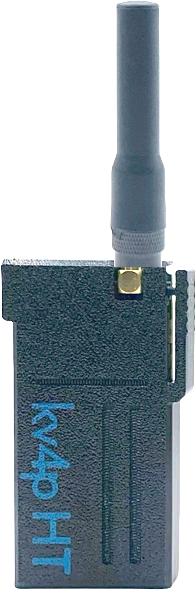
  <div class="two-up-note">
    <ul>
      <li>VHF radio straight into pgpilot over Bluetooth</li>
      <li>Sends both to the app and on VHF</li>
      <li>Works as a repeater between app and radio</li>
    </ul>
  </div>
</div>
```

::: {.notes}
Still beta. Pair it under Menu, Hardware. When you talk, it goes out in the
pgpilot group and on VHF at once, so friends on either hear you. It can relay
between the two.
:::

## Meshtastic, Bircom and FANET

```{=html}
<div class="two-up" style="justify-content:center; gap:70px">
  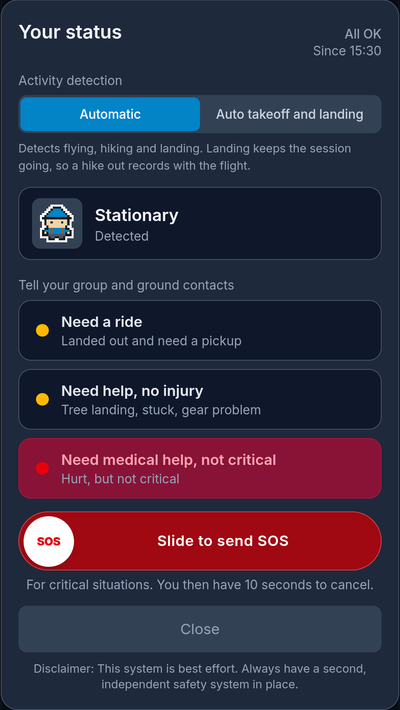
  <div class="two-up-note" style="max-width:600px">
    <ul style="display:flex; flex-direction:column; gap:30px">
      <li>Meshtastic and FANET radios straight into pgpilot</li>
      <li>Status, position and messages over Bircom, no coverage needed</li>
      <li>Ground contacts hear when you take off and when you've landed well</li>
    </ul>
  </div>
</div>
```

::: {.notes}
Most of you already fly with a Meshtastic radio for Bircom. Pair it in pgpilot
and your status, position and messages go over the mesh, no coverage needed.
FANET trackers too. And it works with ground contacts: the friends you
added get a push or an email when you take off and when you've landed well. Close the Meshtastic app first: the radio takes one
Bluetooth client at a time.

Buying a radio: a T-Echo or a SenseCAP T1000-E. Pick 868 MHz in India, the
listings default to 915 or 433.
:::

## InReach

```{=html}
<div class="two-up-note" style="margin:120px auto 0; max-width:900px; font-size:1.15em">
  <ul>
    <li>Your Garmin InReach position straight into pgpilot</li>
    <li>On everyone's map, even with no coverage at all</li>
    <li>Add your MapShare name in Menu → Connected services</li>
  </ul>
</div>
```

::: {.notes}
Inbound only: the app pulls your satellite position in, so the others see you
where nothing else gets through. Not messages, not SOS.
:::

## {background-image="img/volbiv-morning.jpg" background-size="cover" background-position="center 40%"}

```{=html}
<div style="position:absolute; inset:-40px; background:radial-gradient(ellipse at center, rgba(15,23,42,0.72) 0%, rgba(15,23,42,0.35) 70%); display:flex; flex-direction:column; align-items:center; justify-content:center; gap:44px">
  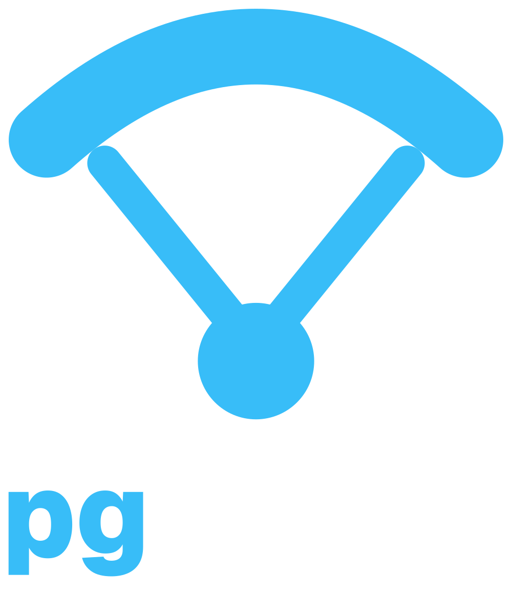
  <p style="margin:0; color:#ffffff; font-size:64px; font-weight:700; letter-spacing:0.01em; text-shadow:0 3px 16px rgba(0,0,0,0.7)">Thank you</p>
  <p style="margin:0; color:#7dd3fc; font-size:30px; text-shadow:0 2px 10px rgba(0,0,0,0.7)">pgpilot.app</p>
</div>
```

