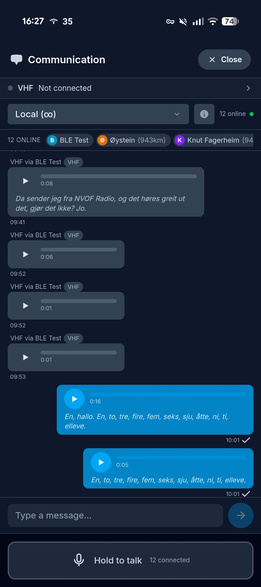
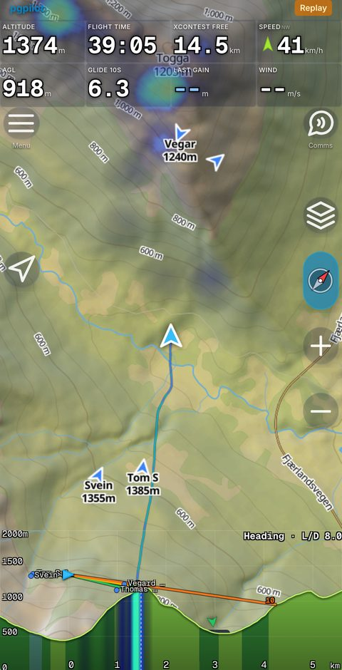
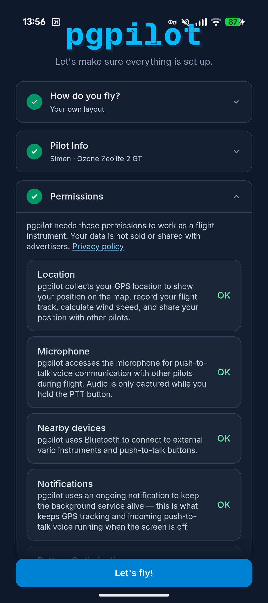
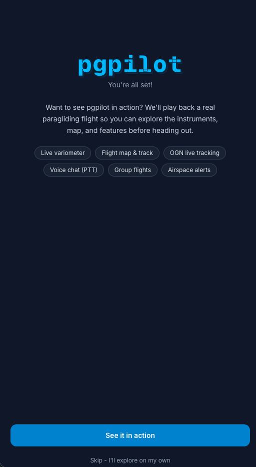
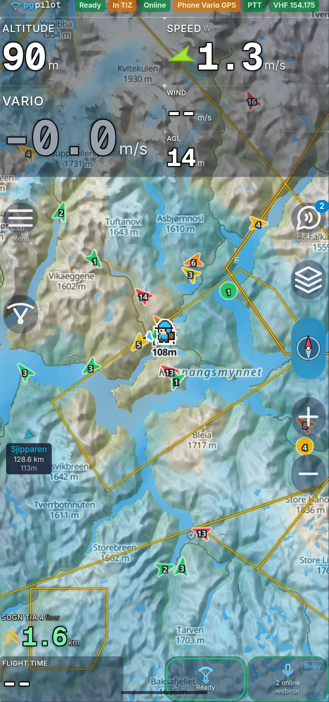
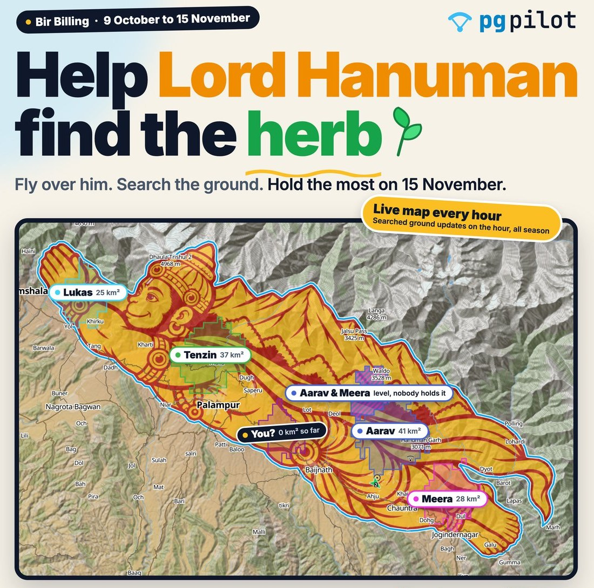
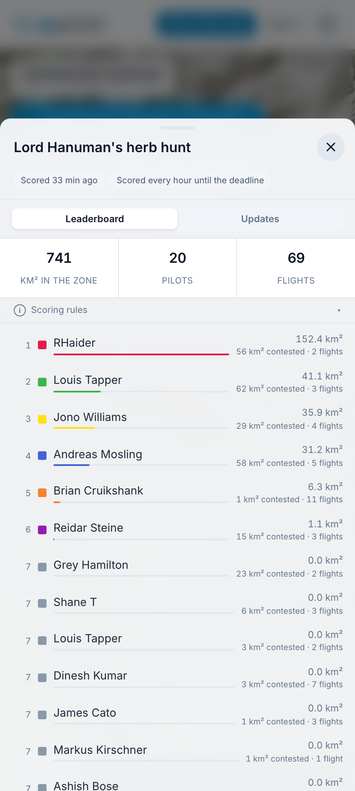
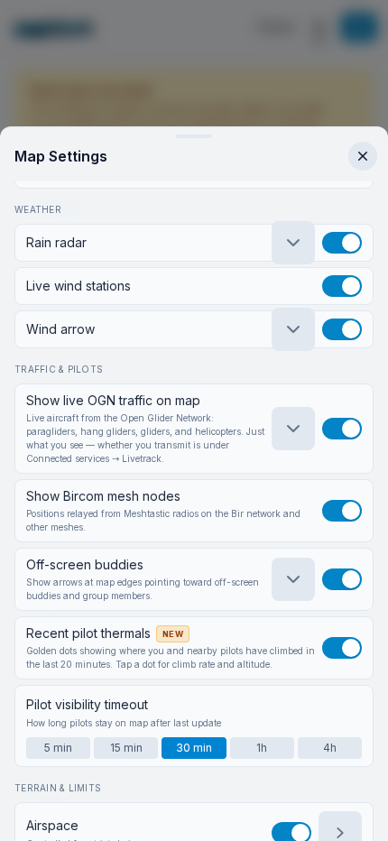
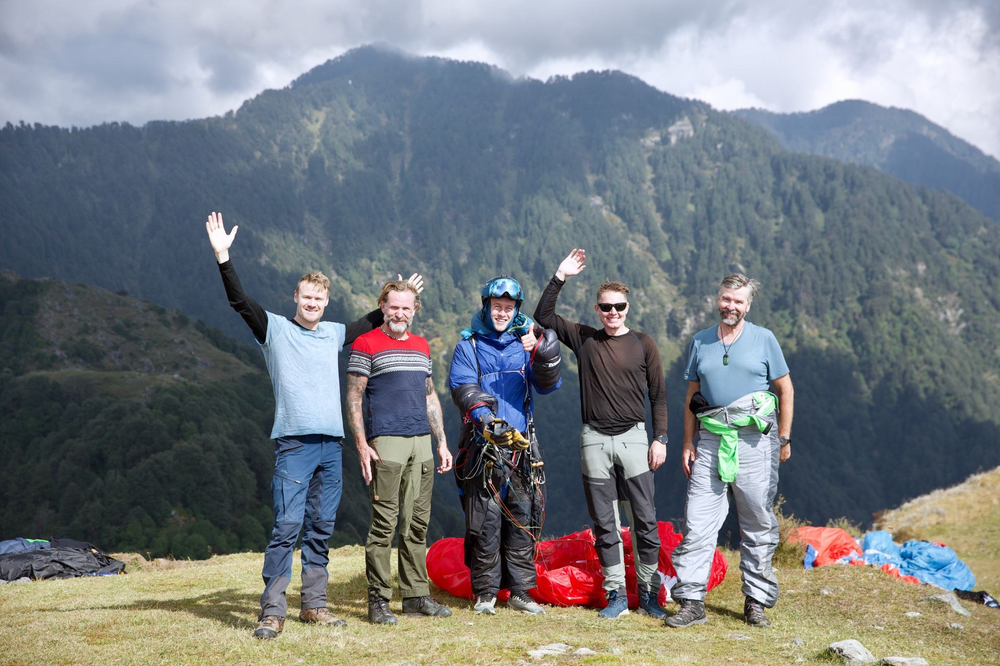

---
# Short version of tutorial.qmd, about 15 minutes, for a live evening at Bir
# Billing. The cut list and time budget are in TUTORIAL-KORT.md next to it.
# Reuses voss.css, img/ and voss-video/.
title: "pgpilot"
subtitle: "Short version, 15 min"
author: "Simen Eide"
lang: en
comments: false
html-math-method: plain
title-slide-attributes:
  data-visibility: hidden
resources:
  - voss-video/
  - img/
format:
  revealjs:
    theme: default
    css: voss.css
    slide-number: true
    width: 1280
    height: 720
    margin: 0
    transition: fade
    auto-stretch: false
    controls: true
    progress: true
    hash: true
    navigation-mode: linear
---

# Get started {.act-divider .hero-slide}

```{=html}
<div class="hero">
  
  
  <div class="hero-text">
    
    <p class="hero-kicker">Bir Billing</p>
  </div>
</div>
```

::: {.notes}
Ten seconds. The goal for the next quarter of an hour: everyone has the app on
the phone and is in the group before they go to dinner. Do it with me as we go.
:::

## What is pgpilot?

```{=html}
<style>
  .feature-tagline {
    display: block;
    margin-top: 0.28em;
    font-family: "Questrial", system-ui, sans-serif;
    font-size: 0.38em;
    letter-spacing: 0.12em;
    text-transform: uppercase;
    color: #38bdf8;
  }
  .feature-cloud {
    display: grid;
    grid-template-columns: minmax(240px, 1fr) 250px minmax(240px, 1fr);
    grid-template-rows: min-content min-content;
    gap: 16px 28px;
    align-items: center;
    margin-top: 10px;
  }
  .feature-stack {
    display: flex;
    flex-direction: column;
    gap: 12px;
    min-height: 0;
  }
  .feature-stack--tl { grid-column: 1; grid-row: 1; }
  .feature-stack--tr { grid-column: 3; grid-row: 1; }
  .feature-stack--bl { grid-column: 1; grid-row: 2; }
  .feature-stack--br { grid-column: 3; grid-row: 2; }
  .feature-image {
    grid-column: 2;
    grid-row: 1 / span 2;
    width: 250px;
    height: 530px;
    margin: 0;
    border: none;
    border-radius: 0;
    box-shadow: none;
    overflow: hidden;
    background: transparent;
  }
  .feature-image img {
    display: block;
    width: 100%;
    height: 100%;
    object-fit: cover;
    object-position: top center;
  }
  .feature-pill {
    display: flex;
    align-items: center;
    gap: 0.6rem;
    width: fit-content;
    max-width: none;
    margin-inline: auto;
    padding: 0.46rem 0.9rem;
    background: #131b29;
    color: #eaf2fb;
    border: 1px solid rgba(73, 143, 205, 0.5);
    border-radius: 999px;
    font-size: 1em;
    line-height: 1.2;
    white-space: nowrap;
    box-shadow: 0 4px 12px rgba(0, 0, 0, 0.14);
  }
  .feature-pill::before {
    content: "";
    width: 8px;
    height: 8px;
    flex: none;
    border-radius: 50%;
    background: #38bdf8;
  }
</style>
<p class="feature-tagline">All in one app</p>
<div class="feature-cloud">
  <div class="feature-stack feature-stack--tl">
    <div class="feature-pill">Flight instrument</div>
    <div class="feature-pill">Live wind</div>
    <div class="feature-pill">Airspace</div>
  </div>
  <div class="feature-image">
    
  </div>
  <div class="feature-stack feature-stack--tr">
    <div class="feature-pill">Weather</div>
    <div class="feature-pill">Task</div>
    <div class="feature-pill">Offline</div>
  </div>
  <div class="feature-stack feature-stack--bl">
    <div class="feature-pill">Group chat</div>
    <div class="feature-pill">VHF radio</div>
    <div class="feature-pill">Tracking</div>
  </div>
  <div class="feature-stack feature-stack--br">
    <div class="feature-pill">Flight log</div>
    <div class="feature-pill">Replay</div>
    <div class="feature-pill">Terrain</div>
  </div>
</div>
```

::: {.notes}
Under a minute. "The flight instrument and Zello in one app, with the weather
for takeoff on top." Point at the groups, don't read the pills.
:::

## Get the app

```{=html}
<div class="install">
  <div class="install-shot">
    
  </div>
  <div class="install-links">
    <div class="store">
      
      <div class="store-name">Android</div>
      <div class="store-sub">Google Play</div>
    </div>
    <div class="store">
      
      <div class="store-name">iPhone</div>
      <div class="store-sub">App Store</div>
    </div>
    <div class="store store-web">
      
      <div class="store-name">Or just</div>
      <div class="store-sub">pgpilot.app</div>
    </div>
  </div>
</div>
```

::: {.notes}
Leave this up while people do it. It's a task, not an illustration.

If the mobile data is slow, the rescue is pgpilot.app in the browser: a viewer
name and nothing more, done in half a minute. Everything tonight works there
except Bluetooth.
:::

## First time you open it

```{=html}
<div class="two-up" style="justify-content:center">
  
  
  
</div>
```

::: {.notes}
Four permissions: location, microphone (only while the button is held),
nearby devices, notifications (or tracking dies when the screen sleeps). Data
isn't sold, say it.

Then "See it in action", not Skip: it replays a real flight, no GPS needed.

Last picture: ready to fly. Green "Ready" in the top bar, and in Active mode
the flight starts by itself at takeoff.
:::

## In the air: thermals and vario

```{=html}
<video class="clip" style="height:555px" src="voss-video/klipp-termikk.mp4"
       poster="img/poster-termikk.jpg"
       data-autoplay loop muted playsinline></video>
```

::: {.notes}
The vario beeps, the app draws the bubble, the wind arrow tightens as you
circle. It learns the wind and the lift from your circles.

This is the app replaying a real flight, same code as live. And none of these
numbers come from the internet: GPS and barometer in the phone.
:::

## Join the group

```{=html}
<div class="joinbox">
  
  <div>
    <p class="join-url" style="font-size:1.15em">pgpilot.app/join/<strong>bir</strong></p>
    <p class="join-sub">Scan, type your name, done.</p>
  </div>
</div>
```

::: {.notes}
CREATE THE GROUP "bir" WHEN YOU RIG, NOT BEFORE. The reaper archives groups
silent for four hours, and then the QR code leads nowhere.

Keep the app open, we use the group for the rest of the talk.
:::

## Talk together

```{=html}
<div class="two-up">
  
  <video class="clip-sm" src="voss-video/klipp-talking.mp4"
         poster="img/poster-talking.jpg"
         data-autoplay loop muted playsinline></video>
</div>
```

::: {.notes}
EVERYONE LISTENS, ONE TALKS. Ask a volunteer to press and talk, and it comes
out of every phone around us at once, no range limit. This is the moment they
get what the app is.

A button on the riser does the same with gloves on. Show it, don't explain it.
:::

## Airgram for Billing

```{=html}
<div class="two-up" style="justify-content:center">
  
  
</div>
```

::: {.notes}
Tap the Billing takeoff on the map. Yellow columns are thermals, darker is
stronger, the top is how high you get. Wind arrows up through the heights,
cloud and rain on top. Here the model is GFS, the only one that covers India.

Today: a classic blue day. Light upslope wind from the south-west, thermals
from about half past nine to half past four, up to around 3,800 m.

Click. Tomorrow: high cloud in the morning, cumulus from about half past one
with bases around 3,500 m, more wind up high and a small chance of a shower in
the afternoon.
:::

## After the flight

```{=html}

```

::: {.notes}
Track, photos, segments, numbers. IGC out, and under Menu, Connected services,
automatic upload to XContest and Flightlog. Nobody uploads by hand any more.

That's the reason they open the app again tomorrow.
:::

## Lord Hanuman's herb hunt

```{=html}
<div class="two-up">
  
  
</div>
```

::: {.notes}
Our game for the season here. Hanuman is lying along the Dhauladhar, from
Dharamshala to Joginder Nagar, about 740 km2. He has lost the herb, and you
help him look for it.

Every time you fly over a patch inside him, you search it once. Whoever has
searched a patch most often holds it; if two are level, nobody does. Flying
straight searches a band either side of your track, wider the further you get
from takeoff. Close a loop and you take everything inside it.

9 October to 15 November. Whoever holds the most ground at the end of 15
November wins a reward. Free, automatic: every flight in the app counts, and
flights from XContest and Flightlog too. It rescores every hour.

Click for the board. (Snapshot from this afternoon, open pgpilot.app/bir for
the live one.) And as the poster says: fly within your limits, no herb is
worth a risk.
:::

## The Bir pack: three radios

```{=html}
<div class="two-up" style="align-items:flex-start; gap:44px; margin-top:112px">
  <div class="two-up-note">
    <p><strong>VHF</strong></p>
    <p>Voice, when nothing else works. A KV4P radio straight on the phone.</p>
  </div>
  <div class="two-up-note">
    <p><strong>LoRa</strong></p>
    <p>Position and short text with no infrastructure. FANET and
    Meshtastic.</p>
  </div>
  <div class="two-up-note">
    <p><strong>Satellite</strong></p>
    <p>When there's no coverage at all. InReach.</p>
  </div>
</div>
```

::: {.notes}
The part that matters here. Behind the first ridge the internet is gone, the
landings have no road out, and nobody is on call. That's why this valley runs
its own radios, and why the app talks to all three.
:::

## VHF on the phone: KV4P <span style="display:inline-block; vertical-align:middle; margin-left:14px; padding:3px 12px; border-radius:999px; background:#f59e0b; color:#0f172a; font-size:0.38em; font-weight:700; letter-spacing:0.08em; text-transform:uppercase">Beta</span>

```{=html}
<div class="two-up" style="justify-content:center; gap:80px">
  
  <div class="two-up-note">
    <ul>
      <li>VHF radio straight into pgpilot over Bluetooth</li>
      <li>Sends both to the app and on VHF</li>
      <li>Works as a repeater between app and radio</li>
    </ul>
  </div>
</div>
```

::: {.notes}
Still beta. Pair it under Menu, Hardware. When you talk, it goes out in the
pgpilot group and on VHF at once, so friends on either hear you. It can relay
between the two.
:::

## Meshtastic, Bircom and FANET

```{=html}
<div class="two-up" style="justify-content:center; gap:60px">
  
  <div class="two-up-note">
    <ul>
      <li>Meshtastic and FANET radios straight into pgpilot over Bluetooth</li>
      <li>Status and position over Bircom and FANET</li>
      <li>Messages over Bircom, no cell signal needed</li>
      <li>Works with pgpilot ground contacts: push and email to friends when you take off and when you've landed well</li>
    </ul>
  </div>
</div>
```

::: {.notes}
Most of you already fly with a Meshtastic radio for Bircom. Pair it in pgpilot
and your status, position and messages go over the mesh, no coverage needed.
FANET trackers too. And it works with ground contacts: the friends you
added get a push or an email when you take off and when you've landed well. Close the Meshtastic app first: the radio takes one
Bluetooth client at a time.

Buying a radio: a T-Echo or a SenseCAP T1000-E. Pick 868 MHz in India, the
listings default to 915 or 433.
:::

## InReach

```{=html}
<div class="two-up" style="align-items:flex-start; gap:44px; margin-top:70px">
  <div class="two-up-note">
    <p><strong>Garmin InReach MapShare</strong></p>
    <p>Under Connected services you enter your MapShare name, the part after
    share.garmin.com/, once.</p>
  </div>
  <div class="two-up-note">
    <p><strong>Inbound, not outbound</strong></p>
    <p>The app pulls your satellite position into pgpilot. It is not a channel
    we transmit to, and not messages or SOS.</p>
  </div>
  <div class="two-up-note">
    <p><strong>For the others</strong></p>
    <p>Your position lands on everyone else's map even where there's no cell
    coverage at all, and someone at home can follow the dot.</p>
  </div>
</div>
```

::: {.notes}
Say it right: inbound only. Enter the MapShare name once, and the others see
you where nothing else gets through. Not SOS.
:::

# See you in the air {.act-divider}

```{=html}


```

::: {.notes}
End on a call to action, not a thank you. The app is free, it's on your phone
now, and the "bir" group stays up as long as people keep using it. Fly with it this
week and tell me what breaks: the feedback button is in the menu.
:::

## {background-image="img/volbiv-morning.jpg" background-size="cover" background-position="center 40%"}

```{=html}
<div style="position:absolute; inset:-40px; background:radial-gradient(ellipse at center, rgba(15,23,42,0.72) 0%, rgba(15,23,42,0.35) 70%); display:flex; flex-direction:column; align-items:center; justify-content:center; gap:44px">
  
  <p style="margin:0; color:#ffffff; font-size:64px; font-weight:700; letter-spacing:0.01em; text-shadow:0 3px 16px rgba(0,0,0,0.7)">Thank you</p>
  <p style="margin:0; color:#7dd3fc; font-size:30px; text-shadow:0 2px 10px rgba(0,0,0,0.7)">pgpilot.app</p>
</div>
```

