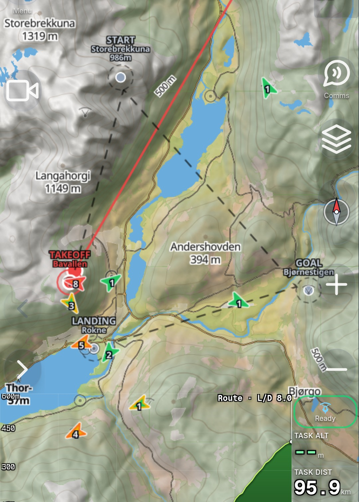
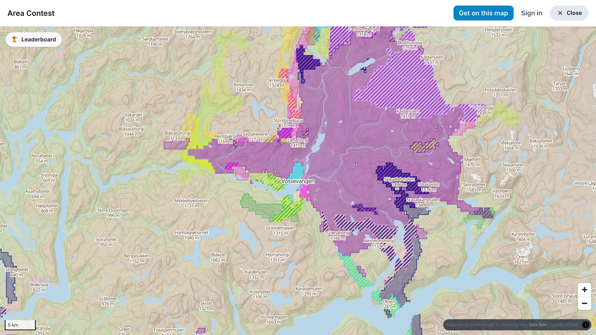
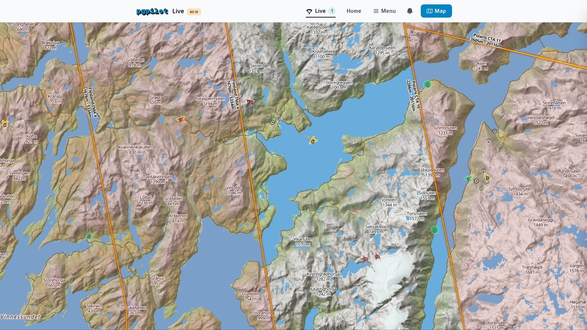
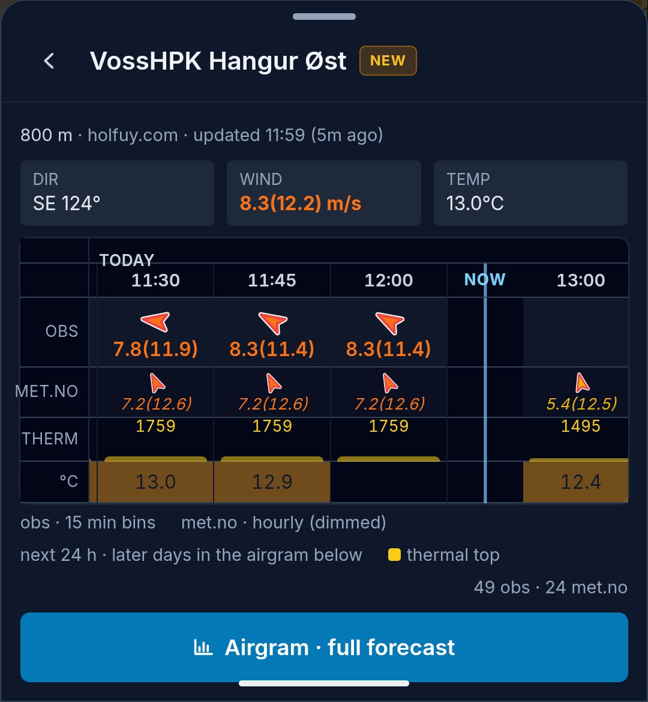
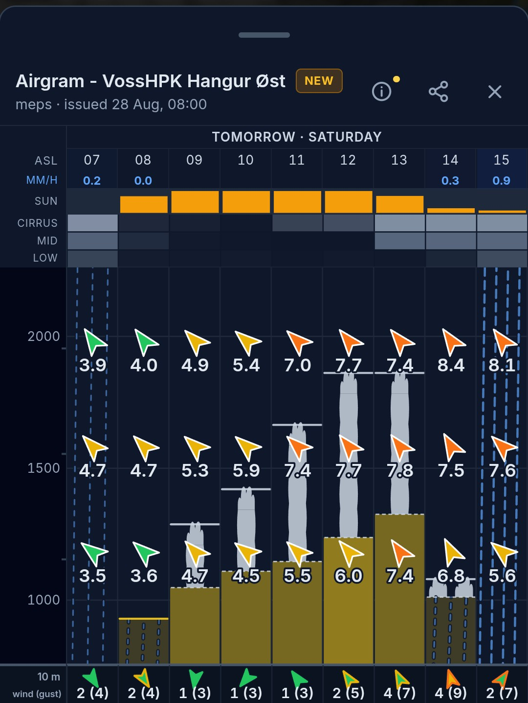
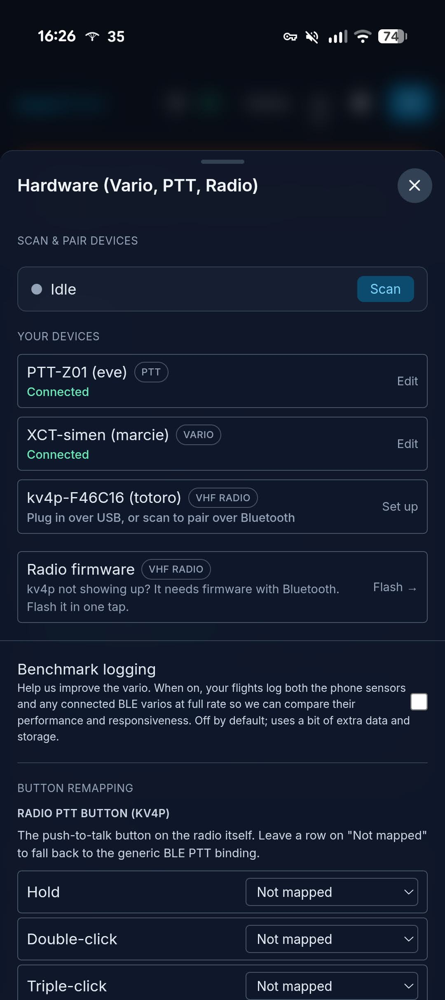
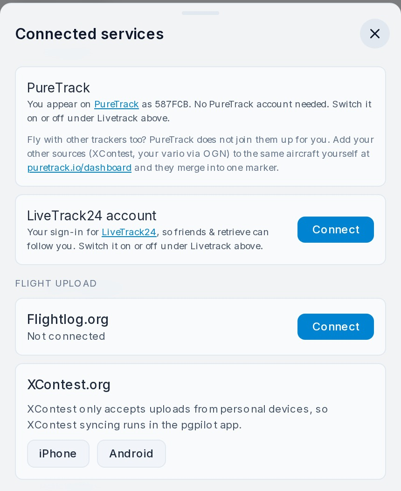
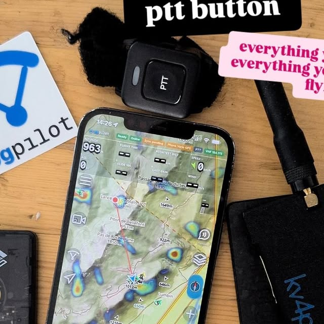

---
# Tutorial webinar, 1 October 2026. Hand-written, with voss.css as the shared
# stylesheet so the two decks look related. Built around six parts:
# introduction, instrument, wind, comms, hardware and the Bir pack.
title: "pgpilot"
subtitle: "Tutorial webinar, 1 October 2026"
author: "Simen Eide"
lang: en
comments: false
html-math-method: plain
title-slide-attributes:
  data-visibility: hidden
resources:
  - voss-video/
  - img/
format:
  revealjs:
    theme: default
    css: voss.css
    slide-number: true
    width: 1280
    height: 720
    margin: 0
    transition: fade
    auto-stretch: false
    controls: true
    progress: true
    hash: true
    navigation-mode: linear
---

# Get started {.act-divider .hero-slide}

```{=html}
<div class="hero">
  
  
  <div class="hero-text">
    
    <p class="hero-kicker">Tutorial webinar, 1 October 2026</p>
  </div>
</div>
```

::: {.notes}
Don't spend long here. Two sentences: this is a walkthrough of the app from
install to comms, and we take it in the order you actually use it.

Say that everything we show, you can do yourself at the same time. It's a
tutorial, not a lecture.
:::

# Part 1: Introduction {.act-divider}

[Part 1]{.act-num}

::: {.notes}
Part 1 has one job: everyone has the app on their phone and is in the group
before we move on.

Feel free to tell them in the channel beforehand: download pgpilot before you
arrive. The store download is the only thing you don't control.
:::

## What is pgpilot?

```{=html}
<style>
  .feature-tagline {
    display: block;
    margin-top: 0.28em;
    font-family: "Questrial", system-ui, sans-serif;
    font-size: 0.38em;
    letter-spacing: 0.12em;
    text-transform: uppercase;
    color: #38bdf8;
  }
  .feature-cloud {
    display: grid;
    grid-template-columns: minmax(240px, 1fr) 250px minmax(240px, 1fr);
    grid-template-rows: min-content min-content;
    gap: 16px 28px;
    align-items: center;
    margin-top: 10px;
  }
  .feature-stack {
    display: flex;
    flex-direction: column;
    gap: 12px;
    min-height: 0;
  }
  .feature-stack--tl { grid-column: 1; grid-row: 1; }
  .feature-stack--tr { grid-column: 3; grid-row: 1; }
  .feature-stack--bl { grid-column: 1; grid-row: 2; }
  .feature-stack--br { grid-column: 3; grid-row: 2; }
  .feature-image {
    grid-column: 2;
    grid-row: 1 / span 2;
    width: 250px;
    height: 530px;
    margin: 0;
    border: none;
    border-radius: 0;
    box-shadow: none;
    overflow: hidden;
    background: transparent;
  }
  .feature-image img {
    display: block;
    width: 100%;
    height: 100%;
    object-fit: cover;
    object-position: top center;
  }
  .feature-pill {
    display: flex;
    align-items: center;
    gap: 0.6rem;
    width: fit-content;
    max-width: none;
    margin-inline: auto;
    padding: 0.46rem 0.9rem;
    background: #131b29;
    color: #eaf2fb;
    border: 1px solid rgba(73, 143, 205, 0.5);
    border-radius: 999px;
    font-size: 1em;
    line-height: 1.2;
    white-space: nowrap;
    box-shadow: 0 4px 12px rgba(0, 0, 0, 0.14);
  }
  .feature-pill::before {
    content: "";
    width: 8px;
    height: 8px;
    flex: none;
    border-radius: 50%;
    background: #38bdf8;
  }
</style>
<p class="feature-tagline">All in one app</p>
<div class="feature-cloud">
  <div class="feature-stack feature-stack--tl">
    <div class="feature-pill">Flight instrument</div>
    <div class="feature-pill">Live wind</div>
    <div class="feature-pill">Airspace</div>
  </div>
  <div class="feature-image">
    
  </div>
  <div class="feature-stack feature-stack--tr">
    <div class="feature-pill">Weather</div>
    <div class="feature-pill">Task</div>
    <div class="feature-pill">Offline</div>
  </div>
  <div class="feature-stack feature-stack--bl">
    <div class="feature-pill">Group chat</div>
    <div class="feature-pill">VHF radio</div>
    <div class="feature-pill">Tracking</div>
  </div>
  <div class="feature-stack feature-stack--br">
    <div class="feature-pill">Flight log</div>
    <div class="feature-pill">Replay</div>
    <div class="feature-pill">Terrain</div>
  </div>
</div>
```

::: {.notes}
The one-liner is "all in one app." Point at the groups instead of reading the
pills: instrument and wind in the air, weather and planning before takeoff,
the group channel while you are out, then the log and replay afterwards.

Keep the oral hook: "It's the flight instrument and Zello in one app, with a
weather report for takeoff on top."

Don't go deeper into any pill here. That comes in parts 2 to 6.
:::

## Get the app

```{=html}
<div class="install">
  <div class="install-shot">
    
  </div>
  <div class="install-links">
    <div class="store">
      
      <div class="store-name">Android</div>
      <div class="store-sub">Google Play</div>
    </div>
    <div class="store">
      
      <div class="store-name">iPhone</div>
      <div class="store-sub">App Store</div>
    </div>
    <div class="store store-web">
      
      <div class="store-name">Or just</div>
      <div class="store-sub">pgpilot.app</div>
    </div>
  </div>
</div>
```

::: {.notes}
Leave this up while people do it. It's a task, not an illustration.

Three ways in:
  - Google Play
  - App Store
  - pgpilot.app in the browser: a viewer name and nothing more. No email, no
    account, done in under half a minute.

The browser route is the rescue for anyone who won't install anything, or has a
full phone. Everything we show today works there, except the Bluetooth part.
:::

## First time you open it

```{=html}
<div class="two-up" style="justify-content:center">
  
  
  
</div>
```

::: {.notes}
Keep this up while they fumble. A harness that stalls on setup, you don't get
going again.

**Step 1, on the left: preflight.** The app asks for four things and explains
why:
  - **Location** for map, track and wind computation.
  - **Microphone** for PTT, and only while the button is held down.
  - **Nearby devices** to find the vario and the button over Bluetooth.
  - **Notifications** so the background service survives the screen turning
    off. Without it, tracking dies when the phone sleeps.

Also say that data isn't sold. It's on the screen, but they believe it more
when you say it.

**Step 2, on the right: "See it in action".** Ask them to tap that, not Skip.
The app plays back a real flight and walks through the instruments while it
rolls. The tour needs neither GPS nor a view, so it works in any room.

If someone tapped Skip, it's still there in the menu. Don't spend time on it
from the stage.

**Step 3, on the far right: ready to fly.** This is what they see when they
close the tour and stand on takeoff. The instruments along the top, the map
with the other pilots, the side view of terrain and airspace at the bottom.
Point at the pills in the top bar: green "Ready" is what they want to see
before takeoff. In Active mode the flight starts on its own when they take off,
no button needed.
:::

## Join the group

```{=html}
<div class="joinbox">
  
  <div>
    <p class="join-url" style="font-size:1.15em">pgpilot.app/join/<strong>webinar</strong></p>
    <p class="join-sub">Scan, type your name, done.</p>
  </div>
</div>
```

::: {.notes}
The group is called **webinar**. Scan the code, type your name, done.

Two things to say clearly:
  - **Keep the app open.** Parts 4 and 6 build on them still being in the group
    later in the session.
  - Everyone listens, one talks. Don't unleash thirty microphones at once.

The group is made when you rig, not before: the reaper archives groups that
have been silent for four hours, and join filters out archived groups. Join
tops up the activity, so once the first ones are in, it keeps itself alive.
:::

# Part 2: The flight instrument {.act-divider}

[Part 2]{.act-num}

::: {.notes}
The core of the app, and the part people already know from other instruments.

The point to land in this part: all of this is computed on the phone, so it
works even when the internet is gone.
:::

## The instrument

```{=html}

```

::: {.notes}
One screenshot, six numbers. Walk through them up top, from the left:
  - **ALTITUDE** and **AGL**: height above sea level and above the ground.
  - **FLIGHT TIME** and **SPEED**.
  - **GLIDE 10S**: glide ratio over the last ten seconds.
  - **XC SCORE** and **WIND**.

At the bottom: the map with your track, the other pilots (Vegar, Svein, Tom S),
and the contour lines. The profile at the very bottom is the terrain under you.

Say the point: none of these numbers come from the internet. They come from the
GPS and the barometer in the phone.
:::

## Thermals and vario

```{=html}
<video class="clip" style="height:555px" src="voss-video/klipp-termikk.mp4"
       poster="img/poster-termikk.jpg"
       data-autoplay loop muted playsinline></video>
```

::: {.notes}
The single most convincing clip, and three things happen at once: the vario
beeps, the app draws the thermal bubble, and the wind arrow tightens while you
circle.

Say it as one point: it doesn't know where the lift is when you take off. It
learns it from your circles, and it remembers where the lift was.

This is a recording of the app playing back a real flight. Same code in replay
as live, so what you see is exactly what you get in the air.
:::

## Plan a task

```{=html}

```

::: {.notes}
Do this live if you can. The slide is your backup.

The task on the image is real Voss terrain. Point at the names:
  - TAKEOFF Bavallen
  - START Storebrekkuna, 986 m, the cylinder is the dashed circle
  - GOAL Bjørnestigen
  - LANDING Rokne
  - TASK DIST 95.9 km, and L/D 8.0 on the route

The cylinders and the dashed legs are drawn straight onto the map. The side
view at the bottom shows the terrain profile under the route, so you see what
you have to get over.

Send it to the group, and ask them to look at their phone. The notification is
called "Load task". Wait for the sound in the room before you move on.
:::

## After the flight

```{=html}

```

::: {.notes}
One slide that does four jobs, so you don't need one per thing:
  - Look at the flight: the map, the track, where you flew.
  - The text and photos you added yourself.
  - The segments: Ground and Flying separated automatically.
  - The numbers: distance, vertical meters, time.

Talk over it about what happens next: IGC out, automatic upload to Flightlog
and XContest, and dedup against what's already there.

This is the reason people open the app again on Tuesday.
:::

## Activity detection

- Detects flying, hiking, ground
- Mode under Menu, My status
  - Automatic: hike and fly
  - Auto takeoff and landing: flights only
- Wrong? Flight summary, Activity, Edit
  - "It was all one flight", or split at the playhead
  - Tap a row to relabel, Undo to step back

::: {.notes}
- Answers "40 min flight saved as three short trips"
- Segments are the flight: airtime, distance, XC score come from them
- Every edit recalculates the numbers, and trains the detector
:::

## AreaContest

```{=html}

```

::: {.notes}
The territories game. Fly a loop around a piece of terrain, and you own what's
inside. Fly straight, and you take a belt on each side of the track, and the
belt gets wider the further you dare go from launch.

Every time you cover the same ground again, your claim gets one notch stronger.
Whoever owns a valley is whoever keeps flying it.

The best retention mechanic in the app, and it costs you nothing to mention.
You can open pgpilot.app/areacontest live if the internet holds.
:::

# Part 3: Live wind {.act-divider}

[Part 3]{.act-num}

::: {.notes}
The wind is the hardest measurement in the whole app, because we don't have a
wind meter. This part is about where the numbers come from, and how far you can
trust them.
:::

## Map over Voss

```{=html}

```

::: {.notes}
The map over Voss, as the audience sees it on the phone. Takeoffs, the
contours, and the other pilots live on the map.

This is the screen you start from. Tap a takeoff marker and the wind comes up.
:::

## Tap Live wind

```{=html}

```

::: {.notes}
What comes up when you tap the takeoff marker: the wind meter standing right
next to the takeoff, Hangur East here.

Each row is a 15-minute average, with gusts in parentheses and the arrow
showing the direction. The blue NOW bar separates the measurements from the
forecast, and the met.no row below sits dimmed next to it, so you see at once
whether the model nailed the day or missed it.
:::

## The airgram

```{=html}

```

::: {.notes}
The airgram: the forecast for takeoff. The yellow columns are the thermals,
darker is stronger, and the top of the column is as high as you'll get. Wind
arrows up through the heights, clouds and sun in the rows at the top, rain as
blue streaks.
:::

# Part 4: Comms {.act-divider}

[Part 4]{.act-num}

::: {.notes}
The new stuff, and the part that makes people stay in the app.

Say it explicitly: everyone listens, one talks.
:::

## Talk together

```{=html}
<div class="two-up">
  
  <video class="clip-sm" src="voss-video/klipp-talking.mp4"
         poster="img/poster-talking.jpg"
         data-autoplay loop muted playsinline></video>
</div>
```

::: {.notes}
Push-to-talk over the internet. You say something, and it comes out of every
phone in the group at the same time, with no range limit.

This is the moment the room understands what the app is. Ask a volunteer to
press and talk, and everyone hears it.

The channel is called Local in the group. Everyone listens, one talks.
:::

## The button on the riser

```{=html}
<div class="two-up">
  
  <video class="clip-sm" src="voss-video/klipp-knapp.mp4"
         poster="img/poster-knapp.jpg"
         data-autoplay loop muted playsinline></video>
  <div class="two-up-note">
    <ul>
      <li>Hold to talk</li>
      <li>Double-click to zoom in</li>
      <li>Triple-click to zoom out</li>
      <li>Tap and hold for the agent</li>
    </ul>
  </div>
</div>
```

::: {.notes}
The little black button in the list, the PTT-Z01, sits on the riser, within
thumb's reach. Hands stay on the brakes, gloves stay on, and the phone stays
where it is.

Four presses, show them with your hand while you talk:
  - **Hold: talk.**
  - **Double-click: zoom in.**
  - **Triple-click: zoom out.**
  - **Tap, then hold: the voice assistant.** "Navigate to Jørgen", "what's the
    wind".

Zoom is the one people underestimate. In the air you don't switch numbers, you
switch the view: in when you're working a bubble, out when you're deciding
where to go next.

Two things that surprise:
  - The screen can be dimmed. Hold the button a little longer than half a
    second and the screen wakes AND the transmission starts.
  - The button works even when pgpilot isn't in front.

Everything can be remapped, and you can pair more than one button. This is
Bluetooth, so it doesn't exist in the browser version.
:::

## The KV4P radio

```{=html}
<div class="two-up">
  
  <div class="two-up-note">
    <ul>
      <li>Transmits on VHF and the pgpilot channel at the same time</li>
      <li>Repeater: turn on "Relay the group out over the radio"</li>
      <li>Dedup: tries to play each transmission once</li>
      <li>Bluetooth, v2.0</li>
    </ul>
  </div>
</div>
```

::: {.notes}
A radio that connects to the phone, instead of a 90s gadget with incomprehensible
menus.

This is how it works in pgpilot: you connect the radio and transmit on both VHF
and the pgpilot channel. You hear both your modern "internet" friends and your
remoter or old-fashioned friends on VHF.

The device can even act as a repeater: it can relay a VHF message into the
pgpilot group, and the group out over VHF. That direction is off by default -
flip **Relay the group out over the radio** in the radio settings to turn it on.

We also have an early dedup: if you hear the same transmission over both radio
and internet, the app tries to play it only once.

The benefits of having the radio on the phone:
  - No fumbling with bad radio menus.
  - We can use radio only when there's no coverage.
  - Headphones pair like with any phone.
  - We can run far better noise cancelling on a phone than the old radios do.

kv4p.com has the list of certified radios. Make sure you get the 2.0 version.
(The 868 MHz advice in part 6 is for the LoRa boards, not this radio.)
:::

# Part 5: Hardware {.act-divider}

[Part 5]{.act-num}

::: {.notes}
What you should actually bring. The goal is that you put the gear on, switch it
on, and it just works.
:::

## Connect your vario

```{=html}

```

::: {.notes}
A screenshot from the phone. It doesn't exist in the web version, because the
Bluetooth code is locked behind isNative().

Three things are connected at the same time here: the BLE vario, the PTT
button and the KV4P radio. That's the whole hardware story in one picture.

The point is auto-connect: we run a background scanner, and the devices show up
within about 15 seconds of you switching them on. You don't tap anything.

If you don't want a vario, the barometer in the phone is enough.
:::

## Which varios work

| Manufacturer | Models confirmed |
| --- | --- |
| XCTracer | XC-Tracer Maxx, Maxx II, Maxx III, Mini |
| Stodeus | UltraBip, BlueBip, MipBip+, MipTrack |
| SkyBean / SkyDrop | SkyDrop, SkyDrop2, SkyBean S0 |
| Syride | SYS'Nav XL, SYS'Evo 2, SYS'Alti 4, SYS'Solar, SYS'GPS 4 |
| BlueFlyVario | BlueFly (BLE and TTL-GPS) |
| Vector Vario | Vector Vario |
| Flymaster | GPS LS 2 |
| DIY | MatiasVario V2 and V3, Microchip RN4678 / RN4871 |

::: {.notes}
There is no whitelist. The app connects to any BLE vario that speaks a standard
serial profile, and reads the standard sentences. "Tons of choices, we support
all that try" is literal.

The table is the narrower claim: models pilots have actually connected and
streamed data from.

Two things worth pulling out:
  - **XCTracer** is the best supported, biggest user base, and sends GPS,
    vario, pressure and battery in one sentence.
  - **Vector Vario** is the only one that also gives us measured wind, heading,
    temperature and humidity instead of us estimating it.

If you have a different device and want it to work, send a message. The
feedback button in the menu works fine.
:::

## Connect the services

```{=html}

```

::: {.notes}
Menu, then **Connected services**. Everything that needs to talk to something
outside the app sits on one page.

At the bottom, under **Flight upload**:
  - **Flightlog.org.** Connect once, and the flights go up by themselves. It
    goes via our server, so the phone doesn't have to do anything.
  - **XContest.org.** Same, but this one has to go from the phone.

Above sits the live tracking: OGN and FLARM, PureTrack, LiveTrack24. One
position out from the phone, on to all the networks, with no extra battery.
InReach sits on the same page, but that one runs the other way, into the app.
More on that in part 6.

The point: nobody uploads anything manually any more.
:::

## The kit

```{=html}
<div class="two-up">
  
  <div class="two-up-note">
    <ul>
      <li><strong>Headphones.</strong> Shokz bone conduction: your ears stay
      open for flying, but you hear the phone.</li>
      <li><strong>The button.</strong> Any GATT BLE button works. I fly with
      two.</li>
      <li><strong>The radio.</strong> KV4P, from part 4.</li>
    </ul>
  </div>
</div>
```

::: {.notes}
The whole set on one board: the phone, the PTT button, the KV4P radio and
headphones.

Three things worth saying about the setup:
  - **Headphones.** Shokz bone conduction is the gold standard: your ears stay
    open for flying, but you hear the phone. A buff over the mic gives pretty
    clean speech.
  - **The button.** Any GATT BLE button works. I fly with two.
  - **The radio.** KV4P, from part 4.

All of this reconnects by itself when you switch it on. That's the whole design
goal: put the gear on, switch it on, fly.
:::

# Part 6: The Bir pack aka off grid {.act-divider}

[Part 6]{.act-num}

::: {.notes}
The last part, and it's about what carries you when the internet doesn't.

Bir is a valley in India where the local community flies with its own radios.
That's why this pack exists, and that's why it's interesting back home too: when
the internet disappears, this is what's left. No forecast, no airspace, and
nobody sees where you are.

Bir itself adds the rest: many landings have no road out, hardly any flat
ground, and no rescue on call. That's why the valley runs its own radios.
:::

## Three radios, three jobs

```{=html}
<div class="two-up" style="align-items:flex-start; gap:44px; margin-top:112px">
  <div class="two-up-note">
    <p><strong>VHF</strong></p>
    <p>Voice, when nothing else works. The KV4P radio from part 4.</p>
  </div>
  <div class="two-up-note">
    <p><strong>LoRa</strong></p>
    <p>Position and short text with no infrastructure. FANET and
    Meshtastic.</p>
  </div>
  <div class="two-up-note">
    <p><strong>Satellite</strong></p>
    <p>When there's no coverage at all. InReach.</p>
  </div>
</div>
```

::: {.notes}
The frame for the whole part. Three technologies, three different jobs, and the
app talks to all three.

VHF is for voice. LoRa is for position and short messages. Satellite is the
last resort.

VHF you already saw in part 4, so the next slides take the other two.
:::

## FANET and FLARM

```{=html}
<div class="two-up">
  
  <div class="two-up-note">
    <ul>
      <li>Position every second</li>
      <li>Landed and distress status</li>
      <li>Short text</li>
      <li>Local weather stations</li>
    </ul>
  </div>
</div>
```

::: {.notes}
FANET with FLARM is what varios like Skytraxx and SoftRF trackers broadcast.
It's what the OGN receivers on the ridges listen for.

With the radio paired under Settings, Connected devices, you get:
  - Every pilot the radio hears, on the map and in Nearby, with names where we
    know them. If the phone has internet, it relays them to the pgpilot
    backend, so friends without a radio see them too, and your own position
    reaches the FANET/OGN world.
  - A pilot who landed, needs a ride, or pressed the distress button shows up
    as exactly that, not as an aircraft with a heading.

Turn the layer on in the map settings. It's the "Show live OGN traffic on map"
switch in the picture.
:::

## Meshtastic and Bircom

```{=html}
<div class="two-up">
  
  <div class="two-up-note">
    <ul>
      <li>Its own mesh, with no ground stations</li>
      <li>Channels as their own rows in Comms</li>
      <li>Works with no cell signal</li>
    </ul>
  </div>
</div>
```

::: {.notes}
Meshtastic is the general-purpose mesh. Messages hop from radio to radio, so a
valley full of pilots is its own network.

In Bir the local community runs Bircom on top of it, and most pilots there fly
with a Meshtastic radio in the harness.

With the radio paired you get:
  - Meshtastic channels as their own rows in Comms. That chat works with no
    cell signal at all, it only needs the Bluetooth link to the radio.
  - FANET text the radio hears is relayed into the Local chat, so a pilot with
    FANET only reaches everyone in the valley, not just the phone that heard
    them.
  - Meshtastic nodes from Bir show up on the map. The switch is called "Show
    Bircom mesh nodes".

You don't need the Meshtastic app on the phone. If you've used it, close it
first: the radio only takes one Bluetooth client at a time.
:::

## InReach

```{=html}
<div class="two-up" style="align-items:flex-start; gap:44px; margin-top:70px">
  <div class="two-up-note">
    <p><strong>Garmin InReach MapShare</strong></p>
    <p>Under Connected services you enter your MapShare name, the part after
    share.garmin.com/, once.</p>
  </div>
  <div class="two-up-note">
    <p><strong>Inbound, not outbound</strong></p>
    <p>The app polls the MapShare feed and pulls your satellite position into
    pgpilot as its own source. It is not a channel we transmit to, and not
    Bluetooth messages or SOS.</p>
  </div>
  <div class="two-up-note">
    <p><strong>For the others</strong></p>
    <p>Your position lands on everyone else's map even where there's no cell
    coverage at all, and someone at home can follow the dot.</p>
  </div>
</div>
```

::: {.notes}
InReach is the last resort, and it's important to explain it right:

This is **inbound**. The app polls the Garmin MapShare KML feed and pulls your
position from the satellite into pgpilot, as its own source. It is not a
channel we transmit to, and it's not Bluetooth messages or SOS.

You enter your MapShare name, the part after share.garmin.com/, once. After
that the others see you on the map even where there's no cell coverage at all,
and someone at home can follow the dot.

In short: VHF for voice, LoRa for position and text, InReach when nothing else
gets through.
:::

## Which LoRa board

```{=html}
<div class="two-up" style="align-items:flex-start; gap:44px; margin-top:70px">
  <div class="two-up-note">
    <p><strong>SenseCAP T1000-E</strong></p>
    <p>Credit-card size, waterproof, GPS and battery built in. The one I'd
    pick, simply because it disappears in a harness pocket.</p>
  </div>
  <div class="two-up-note">
    <p><strong>LILYGO T-Echo</strong></p>
    <p>Bigger, with an e-paper screen, a larger battery and an external
    antenna. Which is why the Bir community made it their standard. Pick this
    if range and battery matter more than size.</p>
  </div>
</div>
```

::: {.notes}
Anything with an nRF52840 and an SX1262 or LR1110 works. Avoid boards with the
older SX127x radio, they have poor range.

  - **SenseCAP T1000-E.** Credit-card size, waterproof, GPS and battery built
    in. Recommended for size.
  - **LILYGO T-Echo.** Bigger, e-paper, bigger battery, external antenna. The
    Bir standard.

Both ship with Meshtastic. If you want FANET instead, you flash SoftRF onto the
same board, and pgpilot sees it as a FANET/FLARM tracker.

**Pick 868 MHz explicitly** if you fly in Europe or India. The listings default
to 915 or 433.
:::

# Your questions {.act-divider}

[From the sign-up form]{.act-num}

::: {.notes}
- Only what the parts didn't cover
- Say at the start whether you record
:::

## Flying with others

- Others don't need to switch
  - OGN/FLARM, XContest, PureTrack, LiveTrack24, InReach show up
- SafeSky: turn on OGN / FLARM in Connected services
- Zello: no import, make the group in pgpilot
- Students: instructor talks to all over PTT, sees everyone

::: {.notes}
- SafeSky rebroadcasts OGN, that's why one switch does both
- Show Connected services on the phone
:::

## Seeing it in the air

- Too dark: Settings, Layout, light mode
- Or a pale map style in Map settings
- Screen setup: pick your fields in Layout
- Airspace above you: "Distance to airspace" field
  - Nearest airspace, its floor, distance

::: {.notes}
- Field is in the ready-to-fly screenshot: "SOGN TIA 4, floor, 1.6 km"
- Check the switches on the phone before you start
:::

## Your flight log

- Three short trips: Edit, "It was all one flight"
- Avg speed vs Flightlog: measured over different spans
- 3D replay of any flight

::: {.notes}
- Split causes: mid-flight restart (fixed), half-uploaded track (being fixed)
- Ask for the flight afterwards, don't debug on stage
- Avg speed: likely whole track vs air time, not verified
- Show a 3D replay if there's time
:::

## What's coming

- Regional forecast
- The airmass model: wind and thermals in one go
  - Weather forecast
  - KK7 thermal maps
  - Live wind
  - Other pilots
  - You
- Drive detection, in test

::: {.notes}
- Regional forecast: full MEPS grid per region, not just per takeoff
- Airmass model: one model learns both, from every source we already have
- Drive: asks "Are you driving?", friends see a car
- No dates
- Then open the floor
:::

# Thanks for today {.act-divider}

```{=html}


```

::: {.notes}
The last word should be a call to action, not a thank you.

The app is free, it's on their phones now, and the **webinar** group stays up.
Feedback I want from people who actually fly: use the feedback button in the
menu.

Remember to mention that they can do everything we showed today themselves,
right away, with the phone they're already holding.
:::
